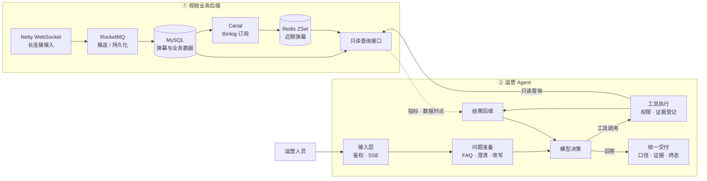
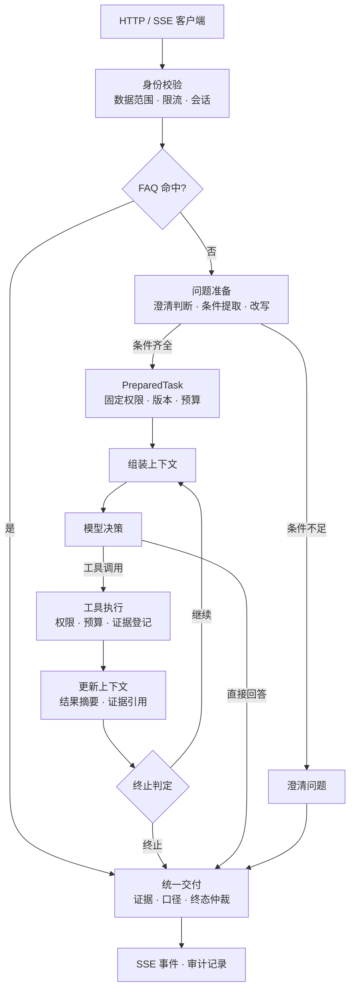

# Tianmu · 天幕

<p align="center">
  <strong>视频弹幕业务底座 + 运营问答 Agent</strong><br/>
  业务系统负责生产与实时分发，Agent 在权限边界内只读查询，以证据交付答案。
</p>

<p align="center">
  <a href="https://github.com/blackirlsama/Tianmu/actions/workflows/ci.yml"></a>
  
  
  
  <a href="LICENSE"></a>
</p>

<p align="center">
  <a href="#概览">概览</a> ·
  <a href="#系统全景">系统全景</a> ·
  <a href="#视频业务后端">视频业务后端</a> ·
  <a href="#运营-agent">运营 Agent</a> ·
  <a href="#快速开始">快速开始</a> ·
  <a href="#质量保障">质量保障</a> ·
  <a href="#文档">文档</a>
</p>

---

## 概览

Tianmu 由两个独立部署、通过受控接口协作的系统组成：

| | 系统 | 定位 |
| --- | --- | --- |
| **①** | **视频业务后端**（根目录 `src/`） | 弹幕视频平台本体：用户、视频、弹幕、关注、文件与检索；负责数据写入、实时推送与历史查询 |
| **②** | **运营 Agent**（[`tianmu-agent/`](tianmu-agent/README.md)） | 面向运营人员的问答系统：理解问题、调用只读工具、校验证据并交付带口径的答案 |

两个系统各自独立构建、独立部署，协作关系见下图。

运营人员提问“查询视频 1001 昨天的弹幕数”，Agent 会依次完成身份校验、问题理解、受控工具调用与证据核验，最终返回带统计口径的答案；条件不足时转为澄清，越权或缺证据的请求不会产生结论。

> **项目状态**：开发预览版（`0.7.0-SNAPSHOT`）。Agent 核心链路、业务桥接、持久化、Hook 与 Trace 已落地；业务口径验收与生产容量仍待推进，详见[路线图](docs/ROADMAP.md)。

## 系统全景



后端负责生产与实时分发，Agent 侧的决策—工具—回填构成循环；两者只通过只读查询交互，写入链路不经过 Agent。

---

## ① 视频业务后端

**定位**：完整可运行的弹幕视频业务系统，既是 Agent 的数据来源，也可独立对外提供业务接口。

### 核心能力

| 域 | 能力 |
| --- | --- |
| **用户体系** | 注册、登录（密码 + 验证码）、登出、JWT 拦截器、邮箱验证码、资料修改 |
| **视频与互动** | 投稿、列表、详情、点赞、投币、收藏、三连、评论、分类 |
| **弹幕链路** | Netty WebSocket 长连接收发；RocketMQ 削峰与持久化；Redis ZSet 保存近期弹幕；历史弹幕查询 |
| **社交关系** | 关注 / 取关、关注列表、粉丝列表 |
| **文件与检索** | MinIO 秒传、分片上传、断点续传；Elasticsearch + IK 视频与用户索引 |
| **数据同步** | Canal 监听 MySQL Binlog 更新缓存；布隆过滤器防穿透 |

### 技术构成

`Spring Boot 3.5` · `MyBatis-Plus` · `MySQL` · `Redis / Redisson` · `Netty` · `RocketMQ` · `Elasticsearch` · `Canal` · `MinIO` · `JWT`

默认端口：HTTP `8101`，Netty WebSocket `9101`。真实运行需要 MySQL、Redis、RocketMQ、Elasticsearch、MinIO 与 Canal，业务表结构需自行初始化。

---

## ② 运营 Agent

**定位**：在明确权限与预算内运行决策循环的问答系统，强调**可控、可观测、可扩展**，而不是自由发挥的聊天机器人。

### 核心特性

| 能力 | 设计要点 |
| --- | --- |
| **权限即边界** | 身份、租户与视频范围在进入循环前固定；有效能力 = 用户权限 ∩ Runtime 策略 ∩ Skill 声明 ∩ 当前激活范围。越权请求不产生工具结果与证据 |
| **证据驱动交付** | 每次查询登记证据 ID、统计口径与数据时点；交付前校验证据归属与引用完整性，伪造或跨任务引用会被拒绝 |
| **受控循环** | 限制轮次、调用次数、总时限与单次超时；同参重复调用、连续失败与用户取消均受控终止，失败任务不输出答案 |
| **可观测与扩展** | OpenTelemetry 贯穿接入、理解、模型、工具与交付；`AgentHook` 提供观察与拦截，`TransformHook<T>` 提供类型化变换，注册期冻结、运行期不可绕过关键校验 |
| **分层持久化** | MySQL 保存正式记录与审计，Redis 缓存可重建的近期会话视图，私有对象存储保存完整结果；支持幂等、澄清续接与重启后查询 |

### 内部分层

```text
tianmu-agent/
├── api/                            # HTTP 接口、鉴权接入、SSE
├── preparation/ application/       # FAQ、并行预处理、历史视图、任务组装、统一交付
├── runtime/                        # 请求编排、模型与工具循环、状态、超时与取消
├── harness/                        # 生命周期 Hook、类型化 Transform、Trace
├── tool/ skill/ prompt/            # 工具执行、能力发现、资源与版本管理
├── access/ query/ model/ adapters/ # 身份、业务查询、模型与存储的端口及实现
├── health/                         # 存活与就绪探针
└── src/main/resources/             # prompts / skills / tools 声明
```

**业务 SQL 留在桥接层，模型协议留在适配器，Skill / Tool / Prompt 分目录维护。** 新能力通过接口与资源声明扩展，不向主循环堆叠业务分支。

### 请求链路与循环



FAQ 先于模型调用，命中即跳过推理；问题准备一次调用完成澄清判断、条件提取与改写。**进入循环后，每一轮都由“组装上下文 → 模型决策 → 工具执行 → 更新上下文”构成**，再由终止判定决定回到下一轮还是交付。终止条件为目标达成、需要澄清、步数上限、预算耗尽、连续无进展或用户取消；所有路径共用同一套交付与终态控制。

## 快速开始

### 方式一：只启动运营 Agent（推荐首次体验）

**环境要求**：JDK 17、Maven 3.6.3+（首次构建需联网下载依赖）。

```bash
git clone https://github.com/blackirlsama/Tianmu.git
cd Tianmu
mvn -B -f tianmu-agent/pom.xml package
java -jar tianmu-agent/target/operations-agent-0.7.0-SNAPSHOT.jar
```

服务监听 `127.0.0.1:8201`，默认启用模拟身份、脚本模型与内存存储，无需 Key、数据库或中间件。

```bash
# 创建任务
curl -s -X POST http://127.0.0.1:8201/api/agent/runs \
  -H 'Authorization: Bearer demo-alice' \
  -H 'Content-Type: application/json' \
  -d '{"message":"查询视频1001昨天的弹幕数"}'

# 查询结果（替换为返回的 runId）
curl -s -H 'Authorization: Bearer demo-alice' \
  http://127.0.0.1:8201/api/agent/runs/RUN_ID
```

接口返回 `202` 与 `runId`；任务完成后结果为标记了**模拟数据**的弹幕数 `128`。还可体验：

- 提问“你能做什么” → 命中 FAQ 直答，跳过模型推理
- 省略日期提问 → 返回 `NEEDS_INPUT` 与澄清问题
- 查询未授权视频 → 返回 `FAILED / FORBIDDEN`，不交付答案

免 Key 自动冒烟：

```bash
python scripts/smoke_demo.py --jar tianmu-agent/target/operations-agent-0.7.0-SNAPSHOT.jar
```

### 方式二：接入真实业务后端

1. 启动视频业务后端所需中间件，并初始化业务表结构；
2. 启动后端并开启 Agent 只读查询；
3. 以 `business,deepseek,persistent` Profile 启动 Agent，配置业务查询地址与数据库凭证。

```bash
mvn -B package                                            # 构建业务后端
AGENT_BRIDGE_ENABLED=true java -jar target/tianmu-*.jar   # 启动后端（含只读查询）
```

配置项见 [`.env.example`](.env.example)，通过运行环境注入；程序不会自动加载 `.env` 文件。真实模型调用会产生费用。

### 运行模式

| Profile | 身份 | 业务数据 | 模型 | 存储 |
| --- | --- | --- | --- | --- |
| `demo`（默认） | 模拟 | 模拟 | 脚本模型 | 内存 |
| `demo,deepseek` | 模拟 | 模拟 | 真实模型 | 内存 |
| `demo,persistent` | 模拟 | 模拟 | 脚本模型 | MySQL / Redis / 私有文件 |
| `business,deepseek,persistent` | 业务登录与权限 | 真实指标 | 真实模型 | MySQL / Redis / 私有文件 |

**当前能力边界**：业务查询覆盖本人未删除视频、最近 30 个已结束自然日的按日弹幕数，统计范围为**当前已入库且仍保留的记录**，不等同于历史发送总量，也不包含消息队列中尚未落库的数据。Token / 费用预算、资源热更新、多实例调度、复杂 RAG 与报告生成尚未实现。

---

## 质量保障

| 验证 | 说明 |
| --- | --- |
| Agent 单元与集成测试 | 15 个测试类、124 个用例，覆盖循环控制、权限负例、Hook 顺序、变换失败语义、Trace 重试与存储边界 |
| 部署契约测试 | `scripts/test_deployment.py` 校验配置模板、凭据边界与 Compose 约束，无需 Docker daemon |
| 持续集成 | [Build and verify](.github/workflows/ci.yml) 分别构建两个工程，执行发布检查与免 Key HTTP / SSE 冒烟 |

```bash
mvn -B verify                              # 视频业务后端
mvn -B -f tianmu-agent/pom.xml verify      # 运营 Agent
python scripts/check_publication.py        # 发布内容与敏感信息检查
git diff --check                           # 空白与冲突标记
```

默认测试无需模型 Key；MySQL / Redis 集成测试需显式启用，并在隔离环境中运行。

## 部署

单机可复现部署栈位于 [`deploy/`](deploy/)，提供 Compose 编排、非 root 只读镜像、凭据外置与 `manage.py` 运维命令，详见[部署说明](docs/DEPLOYMENT.md)。

## 文档

| 文档 | 内容 |
| --- | --- |
| [Agent 开发指南](tianmu-agent/README.md) | 代码分层与扩展入口 |
| [工程目录与扩展规范](tianmu-agent/docs/工程目录与扩展规范.md) | Skill、Tool、Prompt 的开发约定 |
| [接口契约](tianmu-agent/docs/接口契约.md) | 任务、会话、证据、SSE 与错误码 |
| [持久化存储接入](tianmu-agent/docs/持久化存储接入.md) | 事务、缓存、恢复与清理策略 |
| [Harness · Trace 与 Hook](tianmu-agent/docs/Harness-Trace与Hook设计.md) | 治理接口与链路导出 |
| [P0 业务接入](tianmu-agent/docs/P0业务接入.md) | 真实鉴权、查询与 SQL 对账 |
| [路线图](docs/ROADMAP.md) | 可领取的协作任务与验收条件 |

## 参与贡献

欢迎通过 [Issues](https://github.com/blackirlsama/Tianmu/issues) 与 [Pull Requests](https://github.com/blackirlsama/Tianmu/pulls) 参与。提交前请阅读[贡献指南](CONTRIBUTING.md)；涉及跨模块契约的改动请先开 Issue 对齐。

- 安全漏洞请按[安全政策](SECURITY.md)私下报告，不要公开提交 Issue。
- 新增业务工具需同时提供权限负例、口径说明与 SQL 对账结果。
- 修改 `core/`、`runtime/` 等公共契约时，请单独提交并说明兼容性影响。

## 许可证

采用 [MIT License](LICENSE)。第三方组件与服务遵循各自条款，见 [NOTICE](NOTICE) 与[第三方依赖说明](docs/THIRD_PARTY.md)。
