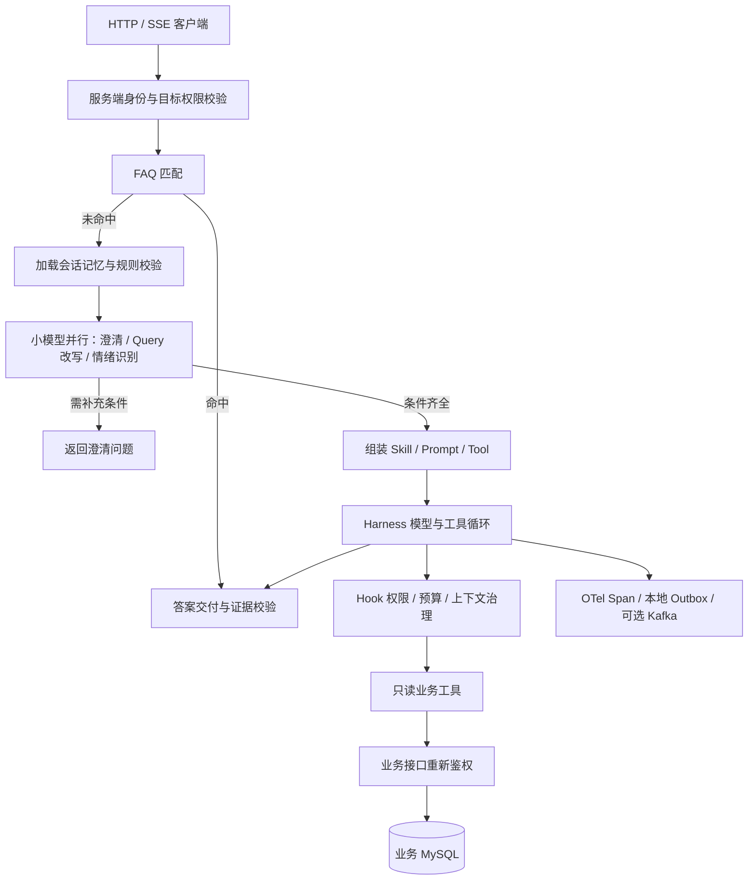

# Tianmu 天幕

视频弹幕后端与可观测运营 Agent。用自然语言查询有权限的视频指标，答案附带证据和统计口径。


[](LICENSE)

**当前为开发预览版。** 默认 Demo 无需模型 Key、数据库或其他中间件；真实业务模式提供 JWT/Redis 登录校验、视频归属授权及只读 SQL 查询。隔离数据库联调和一个真实模型场景已通过，正式账号、现有业务库和生产吞吐仍待验收。

## 先跑 Demo

需要 JDK 17、Maven 3.6.3+；首次构建需要网络下载依赖。Windows、Linux 和 macOS 均可使用 Maven 命令：

```sh
git clone https://github.com/blackirlsama/Tianmu.git
cd Tianmu
mvn -B -f tianmu-agent/pom.xml package
java -jar tianmu-agent/target/operations-agent-0.7.0-SNAPSHOT.jar
```

默认绑定 `127.0.0.1:8201`，使用演示身份、模拟模型和内存存储，不发起收费模型请求。另开终端发起查询：

```sh
# Bash / zsh
curl -s -X POST http://127.0.0.1:8201/api/agent/runs \
  -H 'Authorization: Bearer demo-alice' \
  -H 'Content-Type: application/json' \
  -d '{"message":"查询视频1001昨天的弹幕数"}'
```

Windows PowerShell：

```powershell
$headers = @{ Authorization = 'Bearer demo-alice' }
$body = @{ message = '查询视频1001昨天的弹幕数' } | ConvertTo-Json
$run = Invoke-RestMethod -Method Post -Uri 'http://127.0.0.1:8201/api/agent/runs' -Headers $headers -ContentType 'application/json; charset=utf-8' -Body ([System.Text.Encoding]::UTF8.GetBytes($body))
$run.runId
```

创建返回 HTTP 202 和 `runId`，不会直接返回 SSE。用这个 ID 读取结果或事件：

```sh
curl -s -H 'Authorization: Bearer demo-alice' http://127.0.0.1:8201/api/agent/runs/REPLACE_WITH_RUN_ID
curl -N -H 'Authorization: Bearer demo-alice' http://127.0.0.1:8201/api/agent/runs/REPLACE_WITH_RUN_ID/events
```

演示查询最终返回 **128 条模拟数据**；Alice 只允许访问视频 1001。也可以在未启动服务时运行自动冒烟，它会自行启动并关闭 Java 进程：

```sh
python scripts/smoke_demo.py --jar tianmu-agent/target/operations-agent-0.7.0-SNAPSHOT.jar
```

不要把 Demo 身份用于公网服务。

## 请求链路



| 能力 | 当前实现与边界 |
|---|---|
| 入口与预处理 | FAQ 先短路；未命中后加载记忆、做确定性校验，再并行运行三项模型任务 |
| Harness | 步数、调用次数、超时、取消和终态仲裁；预算尚不包含完整 Token/费用账本 |
| 扩展 | Hook、Tool、Skill、Prompt 分目录；资源从 classpath 加载，修改需构建重启 |
| Trace | OTel、文件 Outbox、可选 Kafka；有故障与重放边界，不承诺零丢失 |
| 存储 | 默认内存；可选 MySQL 权威记录、Redis 会话视图、私有文件产物 |
| 真实业务接入 | JWT 签名与 Redis 在线校验、自己发布的视频、查询时再次鉴权 |
| 首个真实指标 | 按日期统计当前仍保留的已入库弹幕，不等于全部已发送弹幕或历史删除记录 |
| 视频平台 | Netty / RocketMQ / Canal / Redis / MinIO / Elasticsearch；完整平台需要自行部署依赖，尚无统一性能基准 |

## 真实模型、存储与业务模式

变量清单见 [.env.example](.env.example)，具体启动方法见 [部署说明](docs/DEPLOYMENT.md)。Java 不会自动读取 `.env`，需要向进程环境注入。真实 Key、密码和 Token 不要写进源码或文档。

- `demo`：默认，模拟身份、数据和模型。
- `demo,deepseek`：演示权限与数据，真实模型；会产生模型费用。
- `demo,persistent`：演示身份与数据，MySQL/Redis 持久化。
- `business,deepseek,persistent`：真实业务认证与指标、真实模型、Agent 专用存储。

两个 Maven 工程分别构建，根目录并非 Maven 聚合工程。完整视频平台的历史建表迁移尚未整理为可直接初始化的全套脚本，不把它作为首次体验入口。P0 的测试建表文件仅适用于隔离测试，不能用于初始化生产业务库。

## 目录

```text
src/                         视频业务服务（com.orangecode.tianmu）
  main/.../agentbridge/      鉴权与只读指标桥接
  main/resources/db/manual/ 人工审阅的索引与对账 SQL
tianmu-agent/                独立 Agent Maven 工程
  src/main/java/.../         api / runtime / harness / adapters / tool
  src/main/resources/        prompts / skills / tools / faq
  infra/                     可选 MySQL、Redis、Kafka 容器配置
  docs/                      架构、接口与验收记录
scripts/                     发布检查与免 Key 冒烟
docs/                        部署、协作任务与发布说明
面试拷打/                    历史学习笔记，不作为性能或生产验收依据
```

## 验证与参与

当前本地验证包括 Agent 114 项测试、业务模块 14 项测试、此前 P0 的 13 项双服务检查，以及 Flash + V4 Pro 的一次真实模型任务；它们使用隔离测试数据。此次开源整理新增密钥配置测试、发布扫描和默认 Demo 冒烟，最新结果见 [开源准备记录](docs/OPEN_SOURCE_READINESS.md)。GitHub Actions 工作流需推送后才能在远端运行。

- [参与贡献](CONTRIBUTING.md) · [可领取的任务](docs/ROADMAP.md) · [安全反馈](SECURITY.md)
- [总体架构](tianmu-agent/docs/总体架构.md) · [工程扩展规范](tianmu-agent/docs/工程目录与扩展规范.md)
- [接口契约](tianmu-agent/docs/接口契约.md) · [P0 业务接入](tianmu-agent/docs/P0业务接入.md)
- [P0 验收记录](tianmu-agent/docs/P0业务接入验收.md) · [第三方依赖](docs/THIRD_PARTY.md)

接下来优先做正式业务环境验收、完整建表迁移和可复现部署、指标与模型评测，再扩展业务工具。欢迎从文档、测试和单个 Tool 开始贡献。

## 许可证与来源

本项目原名 DokiTV，现为 Tianmu，保留 Git 历史中的作者记录，按 [MIT](LICENSE) 授权。第三方组件和模型服务适用各自条款，见 [NOTICE](NOTICE)。
