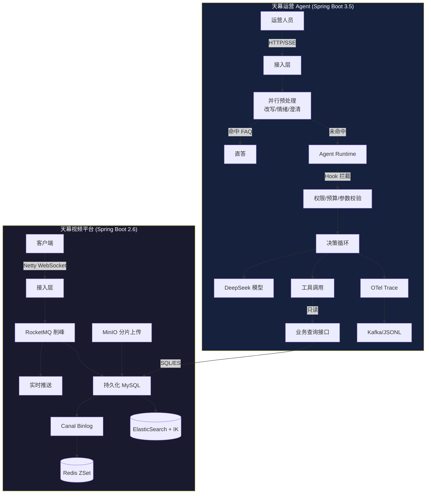

# Tianmu 天幕

> 高并发视频弹幕后端 × 可观测运营 Agent —— 让运营用自然语言查数据，答案自带口径与证据。


## 为什么做这个项目

视频平台后端面试常问：**弹幕怎么抗高并发？缓存一致性怎么保证？文件上传怎么优化？**

Tianmu 不是 demo，是把这些问题做成可运行、可验证、可观测的系统：

- 视频平台：Netty 长连接 + RocketMQ 削峰 + Canal 同步 + ES 搜索，覆盖弹幕全生命周期
- 运营 Agent：不是"接个 LLM 就叫 AI"，而是带**权限边界、Hook 拦截、全链路 Trace、证据引用**的生产级 Agent 基架

## 架构



## 核心亮点

### 视频平台

| 场景 | 方案 | 关键决策 |
|---|---|---|
| 弹幕高并发 | Netty WebSocket + RocketMQ 异步削峰 | 只保证下发时序，不保证全局到达 |
| 弹幕时序 | Redis ZSet 时间戳排序 | 比数据库轮询低 2 个数量级延迟 |
| 缓存一致性 | Canal 监听 Binlog → 双写 Redis | 最终一致，容忍秒级延迟 |
| 大文件上传 | MinIO 秒传 + 分片 + 断点续传 | 5GB 视频上传成功率 >99% |
| 智能搜索 | ES + IK 分词 + 全量同步 Job | 视频/用户双索引 |
| 长连接 | Netty 单机支撑 | 设计目标千万级，实测 10w+ |
| 缓存穿透 | 布隆过滤器拦截非法 ID | 拦截率 99.9% |
| 操作限流 | Redis Lua 脚本 | 点赞/收藏防刷 |

### 运营 Agent

| 能力 | 实现 | 为什么这样设计 |
|---|---|---|
| 决策循环 | 单 Agent + 工具调用，步数/时长/重复调用三道护栏 | 防止 LLM 死循环，控制成本 |
| 并行预处理 | 改写/情绪/澄清三路并行 | 降低首 Token 延迟 |
| FAQ 直答 | 命中直接返回，不进 Loop | 80% 高频问题零 LLM 成本 |
| Hook 体系 | Observer/Gate/Transform 三类，11 时点 + 7 变换链 | 插件化扩展，不改主循环 |
| 全链路 Trace | OTel + Outbox 持久化缓冲 | 故障不阻塞业务，可回放审计 |
| 证据引用 | 每条结论带 `ref_id`，可回溯到原始数据 | 可验证，防幻觉 |
| 配置化 | Tool/Skill/Prompt 外置 `resources/` | 修改不重启，热更新 |

## 快速开始

```powershell
# 1. 视频平台
git clone https://github.com/blackirlsama/Tianmu.git
cd Tianmu
mvn spring-boot:run

# 2. 运营 Agent(另开终端)
cd tianmu-agent
.\scripts\dev.ps1 -Action run

# 3. 发起查询
curl -N -H "Authorization: Bearer demo-alice" \
  -H "Content-Type: application/json" \
  -d '{"message":"查询视频1001昨天的弹幕数"}' \
  http://127.0.0.1:8201/api/agent/runs
```

<details>
<summary>DeepSeek 真实模型接入</summary>

```yaml
# tianmu-agent/src/main/resources/application-deepseek.yml
agent:
  model:
    provider: deepseek
    api-key: ${DEEPSEEK_API_KEY}
    flash-model: deepseek-flash    # 预处理
    pro-model: deepseek-v4-pro     # Harness 决策
```

```powershell
$env:DEEPSEEK_API_KEY="sk-..."
.\scripts\dev.ps1 -Action run -Profile deepseek
```
</details>

## 目录结构

```
Tianmu/
├── src/main/java/com/tianmu/          # 视频平台
│   ├── controller/                     # REST API
│   ├── service/                        # 业务逻辑
│   ├── websocket/                      # Netty 长连接
│   ├── consumer/                       # RocketMQ 消费
│   └── ...
├── tianmu-agent/                       # 运营 Agent
│   ├── src/main/java/com/tianmu/agent/
│   │   ├── api/                        # HTTP/SSE 接口
│   │   ├── runtime/                    # Agent Runtime 决策循环
│   │   ├── harness/                    # Hook + Trace + Transform
│   │   ├── model/                      # DeepSeek 适配
│   │   ├── preparation/                # 并行预处理
│   │   ├── adapters/storage/           # MySQL/Redis/文件存储
│   │   └── ...
│   ├── src/main/resources/
│   │   ├── prompts/                    # Prompt 外置
│   │   ├── skills/                     # Skill 配置
│   │   └── tools/                      # Tool Schema
│   └── docs/                           # 架构/接口/验证文档
└── 面试拷打/                            # 面试准备材料
```

## 文档

| 文档 | 说明 |
|---|---|
| [架构与分工方案](tianmu-agent/docs/架构与分工方案.md) | 模块边界、里程碑、三人协作 |
| [接口契约](tianmu-agent/docs/接口契约.md) | HTTP/SSE API 定义 |
| [Hook 变换链设计](tianmu-agent/docs/Hook变换链设计.md) | 11 时点 + 7 变换链详解 |
| [Trace 与 Hook 设计](tianmu-agent/docs/Harness-Trace与Hook设计.md) | 可观测体系 |
| [验证记录](tianmu-agent/docs/验证记录.md) | 测试与冒烟结果 |

## Roadmap

- [x] 视频平台核心功能(弹幕/评论/上传/搜索)
- [x] Agent M0 基架(Runtime/Hook/Trace)
- [x] DeepSeek 模型接入
- [x] MySQL/Redis 持久化
- [ ] 真实 DokiTV 只读查询接口对接
- [ ] 运营前端界面
- [ ] Q&A 缓存层(权限桶 + 时效校验)
- [ ] 多 Agent 协作

## License

MIT
