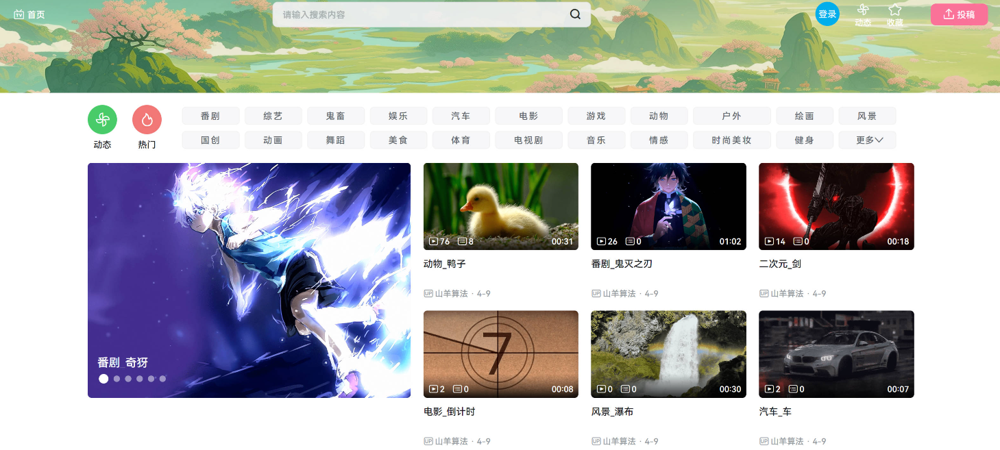
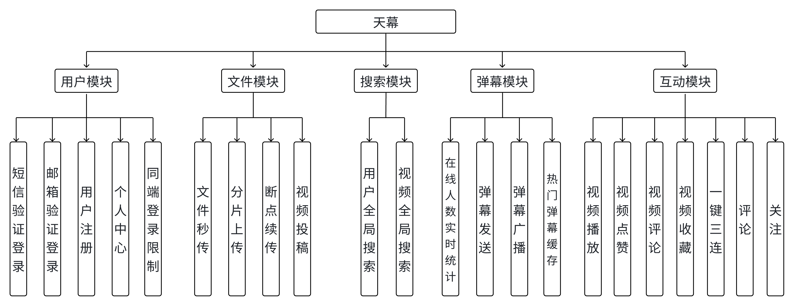
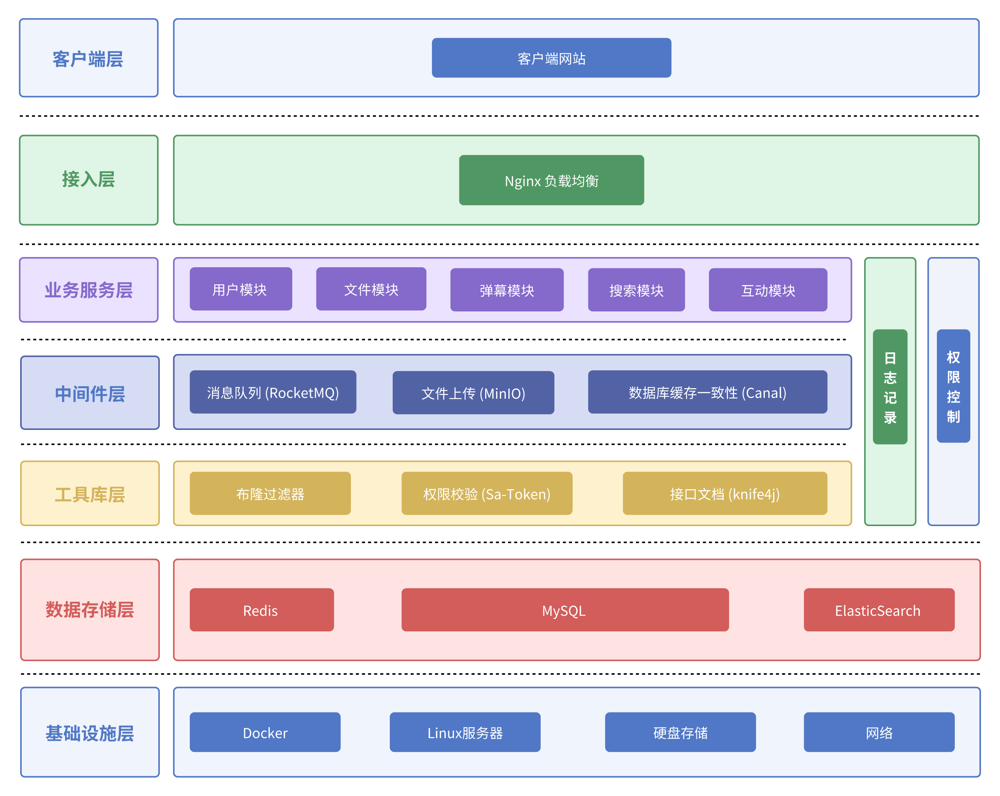

# Tianmu 视频互动平台

## 项目简介

Tianmu(天幕)是一款**高并发、易扩展的视频互动平台**,聚焦视频播放、实时弹幕、用户互动等核心场景,旨在解决传统视频平台架构老旧、扩展性弱的问题,同时通过技术落地展示主流互联网产品的底层实现逻辑。

仓库包含两个子项目:

| 模块 | 说明 | 技术栈 |
|---|---|---|
| 根目录(`com.orangecode.tianmu`) | 视频互动平台后端:视频、弹幕、评论、关注、上传、搜索 | Spring Boot 2.6 / Netty / RocketMQ / ES / Canal / MinIO |
| [tianmu-agent](tianmu-agent/) | 运营问答 Agent:自然语言查询视频互动数据,带证据引用的可观测 Agent 基架 | Spring Boot 3.5 / DeepSeek / OpenTelemetry / Kafka / MySQL+Redis 持久化 |

## 效果预览


## 项目背景

随着视频内容生态的爆发,市面上多数老旧项目存在架构僵化、并发支撑不足的问题。Tianmu 平台以"易扩展、高性能"为核心目标:

1. 区别于传统老旧项目,采用分层架构+微服务思想设计,适配高并发场景;

2. 预留充足扩展接口,支持后续功能迭代(如直播、付费内容等);

3. 落地主流中间件与架构方案,还原生活中常用视频APP的底层技术原理。

## 产品亮点

- **架构领先**:摆脱传统项目的技术栈,采用现代化分层架构,适配高并发、高可用场景;

- **易扩展性**:模块解耦+中间件抽象,后续新增功能(如直播、社区)无需重构核心架构;

- **技术落地**:通过实际场景(如实时弹幕、文件秒传)展示互联网产品的底层实现逻辑,兼具学习与实用价值。

## 技术亮点

1. **高并发视频播放优化**:通过Nginx负载均衡+静态资源缓存,提升视频播放的稳定性与响应速度;

2. **实时弹幕高并发处理**:基于RocketMQ实现弹幕异步削峰,高峰期保障弹幕的实时性与系统稳定性;

3. **缓存数据一致性保障**:通过Canal监听MySQL Binlog,实现Redis与数据库的最终一致性;

4. **高性能文件处理**:基于MinIO实现文件秒传、分片上传、断点续传,提升大文件(视频)的上传成功率;

5. **千万级实时长连接**:通过Netty实现长连接管理,支撑高并发场景下的实时互动(如弹幕、点赞通知);

6. **智能搜索体系**:基于ElasticSearch + IK分词器实现精准、高效的内容搜索与聚合;

7. **弹幕时序性保障**:采用Redis Zset存储弹幕数据,实现按时间戳自动排序,确保弹幕展示的时序正确性;

8. **缓存穿透防护**:通过布隆过滤器拦截非法视频ID请求,避免缓存与数据库的无效查询;

9. **安全认证体系**:基于JWT实现登录验证,支持同端登录检测与请求拦截;

10. **操作频率限制**:通过Redis Lua脚本实现点赞、收藏等操作的频率控制,保护系统资源。

## 运营问答 Agent(tianmu-agent)

面向运营人员的自然语言数据问答后端,与视频平台解耦、只读接入:

- **Agent Runtime 决策循环**:单 Agent 工具调用闭环,步数/时长/重复调用三道护栏,支持协作式取消;
- **DeepSeek 真实模型接入**:结构化决策解析(回答/澄清/read_skill/工具调用),连接与读取超时控制;
- **并行预处理**:统一入口并行执行改写、情绪识别、澄清判断,Prompt 全部资源外置;
- **FAQ 直答层**:标准问答命中直接返回,不进 Loop;
- **Hook 扩展体系**:Observer / Gate / Transform 三类 Hook,11 个时点 + 7 条类型化变换链;
- **全链路 Trace**:OpenTelemetry + Outbox 持久化缓冲,本地 JSONL / Kafka 双出口,故障不阻塞业务;
- **持久化存储**:MySQL(Flyway 迁移)/ Redis 记忆缓存 / 文件对象存储,重启可回放;
- **配置化 Tool/Skill**:`list_skills` → `read_skill` 渐进披露,权限交集服务端二次校验。

详细设计见 [tianmu-agent/docs](tianmu-agent/docs/),接口契约见 [接口契约.md](tianmu-agent/docs/接口契约.md)。





## 技术选型

| 技术栈 | 版本号 |
| ----- | ----- |
| SpringBoot | 2.6.13 / 3.5.4(多服务适配) |
| JDK | 17 |
| Maven | 3.6.1 |
| MySQL | 8.0 |
| Canal | v1.1.7 |
| RocketMQ | 5.2.0 |
| ElasticSearch | 7.17.23 |
| Kibana | 7.17.23 |
| IK 分词器 | 7.17.23 |
| MinIO | RELEASE.2025-02-18T16-25-55Z |
| Redis | 7.4.0 |
| DeepSeek | deepseek-flash / deepseek-v4-pro(Agent 模块) |
| OpenTelemetry | 1.x(Agent 模块 Trace) |
| Kafka | 3.x(Agent 模块 Trace 可选出口) |
| npm | 11.0.0 |
| Node | v22.11.0 |

## 快速开始

视频平台与 Agent 为两个独立 Spring Boot 应用,可分别启动:

```powershell
# 视频平台(根目录)
mvn spring-boot:run

# 运营 Agent(默认 127.0.0.1:8201,演示身份 Bearer demo-alice)
cd tianmu-agent
.\scripts\dev.ps1 -Action run
```
