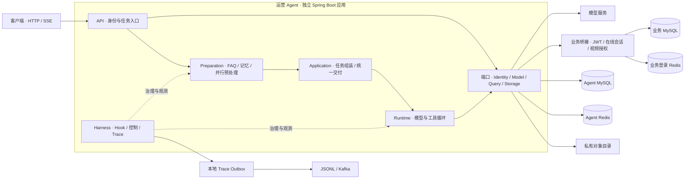
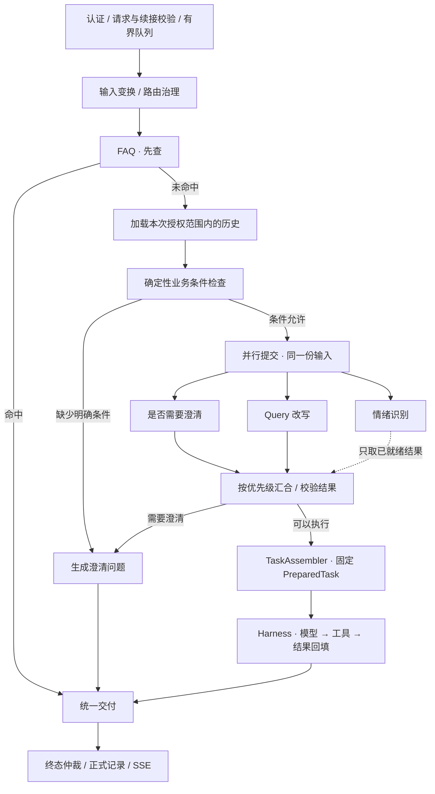

# Tianmu · 天幕

**面向视频弹幕业务的运营问答 Agent，以受控执行、业务证据和可观测链路为核心。**


[](LICENSE)

[快速开始](#快速开始) · [工程架构](#工程架构) · [扩展开发](#扩展开发) · [部署配置](docs/DEPLOYMENT.md) · [参与贡献](CONTRIBUTING.md)

Tianmu 将自然语言问题转换为有权限边界、有统计口径、可追溯的业务查询。例如，用户提出“查询视频 1001 昨天的弹幕数”，系统完成身份校验、问题准备、Skill 加载和工具执行，再结合结构化证据交付答案。

仓库包含视频业务后端与独立的运营 Agent。视频后端负责业务数据生产和管理；Agent 通过业务桥接接口访问授权数据，负责问答编排与执行治理。两者分别构建、分别运行，Agent 的默认 Demo 可以独立体验。

> **项目状态：开发预览版。** 已提供免 Key Demo、真实模型适配、业务鉴权桥接、持久化、Hook 与 Trace。接口仍可能演进；正式业务环境验收、完整平台部署和生产容量验证尚待完成。具体边界见[当前能力与边界](#当前能力与边界)。

## 核心能力

- **统一问答入口**：FAQ 命中直接交付；未命中时加载会话历史，经过确定性校验和并行预处理，再决定澄清或进入 Harness。
- **受控 Agent 循环**：模型决策、工具执行与结果回填分离，具备轮次与调用次数上限、截止时间、取消、连续失败保护和无工具收尾。
- **业务证据交付**：指标查询返回数值、来源、口径版本、查询时点与证据引用；最终交付校验证据归属并补充业务口径。
- **可扩展治理**：通过生命周期 Hook 和类型化 Transform 接入观察、拦截、输入处理、结果脱敏与答案格式化。
- **分层存储**：MySQL 保存正式记录，Redis 缓存近期会话视图，私有对象存储保存完整结果，支持幂等提交、澄清续接和重启后查询。
- **全链路观测**：OpenTelemetry Span 关联请求、预处理、模型、工具与交付，经过本地文件 Outbox 导出到 JSONL 或 Kafka。

## 快速开始

需要 **JDK 17** 和 **Maven 3.6.3+**；首次构建需要下载依赖。默认 Demo 使用模拟身份、模拟模型和模拟指标，无需模型 Key、数据库或 Docker。

### 1. 构建并启动

```sh
git clone https://github.com/blackirlsama/Tianmu.git
cd Tianmu

mvn -B -f tianmu-agent/pom.xml package
java -jar tianmu-agent/target/operations-agent-0.7.0-SNAPSHOT.jar
```

默认监听 `127.0.0.1:8201`，启用 `demo` profile。任务与对话使用内存存储，重启后不保留；Trace 默认写入本地 `./var/trace`。

### 2. 提交问题

Bash / zsh：

```sh
curl -s -X POST http://127.0.0.1:8201/api/agent/runs \
  -H 'Authorization: Bearer demo-alice' \
  -H 'Content-Type: application/json' \
  -d '{"message":"查询视频1001昨天的弹幕数"}'
```

Windows PowerShell：

```powershell
$headers = @{ Authorization = 'Bearer demo-alice' }
$body = @{ message = '查询视频1001昨天的弹幕数' } | ConvertTo-Json
$run = Invoke-RestMethod -Method Post `
  -Uri 'http://127.0.0.1:8201/api/agent/runs' `
  -Headers $headers -ContentType 'application/json; charset=utf-8' `
  -Body ([System.Text.Encoding]::UTF8.GetBytes($body))

Invoke-RestMethod -Uri "http://127.0.0.1:8201/api/agent/runs/$($run.runId)" -Headers $headers
```

创建接口返回 **HTTP 202** 和 `runId`，表示任务已接收。后续通过状态接口或 SSE 获取结果；如果仍为 `QUEUED` / `RUNNING`，继续查询。

### 3. 查看结果与事件

将 `RUN_ID` 替换为创建响应中的 `runId`：

```sh
curl -s -H 'Authorization: Bearer demo-alice' \
  http://127.0.0.1:8201/api/agent/runs/RUN_ID

curl -N -H 'Authorization: Bearer demo-alice' \
  http://127.0.0.1:8201/api/agent/runs/RUN_ID/events
```

该示例最终返回标记为**模拟数据**的弹幕数 **128**。Demo 中 Alice 仅能查询视频 1001。提问“你能做什么”可体验 FAQ 短路；省略日期可体验澄清。

也可以自动执行 HTTP / SSE 冒烟验证，脚本会启动临时进程、校验结果并关闭进程：

```sh
python scripts/smoke_demo.py --jar tianmu-agent/target/operations-agent-0.7.0-SNAPSHOT.jar
```

Demo 凭证为公开固定值，仅用于本机体验。

## 工程架构

### 系统组成与部署边界

项目采用**业务后端与 Agent 分离、Agent 内部按职责分包**的结构。根 Maven 工程承载视频业务和桥接入口；`tianmu-agent` 是独立 Maven 工程，内部组件通过 Java 接口协作。根目录不是 Maven 聚合工程。



业务桥接有两种运行方式：嵌入原视频服务，或使用独立的只读桥接应用，默认监听 `127.0.0.1:8202`。独立桥接只启动鉴权与查询所需组件，接入 Agent 时无需启动完整视频平台。

| 工程 / 组件 | 职责 | 边界 |
| --- | --- | --- |
| 视频业务后端 | 视频、用户、互动、弹幕及业务数据链路 | 使用 Netty、RocketMQ、MySQL、Redis、Canal、MinIO、Elasticsearch 等组件 |
| 业务桥接 `agentbridge` | 验证登录、解析可信身份、检查视频归属、执行固定指标 SQL | 不接收模型生成的 SQL；使用独立只读连接池 |
| 运营 Agent `tianmu-agent` | 请求准备、模型决策、工具调度、会话与交付 | 通过业务端口访问指标，不直接查询业务表 |
| 外部模型服务 | 情绪、澄清、改写与主循环决策 | 预处理与主循环分别配置模型；Key 从运行环境注入 |
| Agent 存储与 Trace | 保存正式记录、证据、产物和执行轨迹 | 与业务数据库分开配置、分开迁移 |

### 请求链路：哪些串行，哪些并行



1. **先授权，再处理问题。** 服务端生成身份和资源范围，输入变换与 FAQ 查询都处于受控请求内。
2. **FAQ 先于模型调用。** 命中后跳过预处理模型和主循环，仍使用相同的任务与交付协议。
3. **记忆和规则先于并行分析。** 历史视图按本次授权范围过滤；确定性规则能识别的缺失条件直接追问。
4. **三项分析并行，汇合有优先级。** 澄清决定是否继续；改写超时或校验失败回到原文；情绪只使用已完成结果，不单独延长等待。需要澄清时取消无用分支。
5. **进入循环前固定任务。** `PreparedTask` 保存原始问题、执行 Query、业务日期、条件来源、权限范围、资源版本、工具上限与截止时间。改写不能凭空补造视频或日期条件。
6. **所有路径统一交付。** FAQ、澄清、模型答案和工具直接交付共用交付治理与终态仲裁，晚到结果不能覆盖已提交终态。

### Agent 内部分层

以下路径均相对于 `tianmu-agent/src/main/java/com/tianmu/agent/`：

| 层 / 目录 | 主要组件 | 职责 |
| --- | --- | --- |
| `api/` | `AgentController`、`StorageController`、`SseEventStreams` | HTTP 契约、鉴权接入、事件订阅与读取 |
| `preparation/` | `PreparationService`、`QueryReadinessPolicy`、`TaskSpecificationResolver` | FAQ、条件检查、并行分析、结果校验与路由 |
| `application/` | `TaskAssembler`、`MemoryBuilder`、`DeliveryService` | 固定执行任务、构造历史视图、统一交付 |
| `runtime/` | `RequestOrchestrator`、`AgentRuntime`、`RunService` | 用例编排、循环、任务状态和调度；入口编排类当前位于此包 |
| `runtime/control/` | `CallControl`、`CancellationToken`、`TurnControl` | 截止时间、取消传播和终态竞争 |
| `harness/` | `RuntimeHarness`、Hook、Transform、Trace | 跨阶段治理、类型化变换和链路观测 |
| `tool/`、`skill/`、`prompt/` | Dispatcher、Registry、Catalog | 工具执行与准入、能力发现、版本化资源加载 |
| `access/`、`query/`、`model/` | 身份、业务查询、模型端口 | 隔离业务系统与模型提供方的具体协议 |
| `adapters/`、`demo/` | 业务 / 存储适配器、Demo 实现 | 外部依赖接入与本地可运行实现 |

设计上的约束是：业务 SQL 留在业务桥接；模型协议留在模型适配器；Prompt、Skill 与工具声明留在资源目录。主循环协调模型和工具，不承载这些具体实现。

### Harness：执行治理与扩展

Harness 在固定阶段调用扩展，治理插件通过 Spring Bean 注册。

| 机制 | 扩展接口 | 执行语义 |
| --- | --- | --- |
| 生命周期观察 / 拦截 | `AgentHook` | 13 个生命周期点；按 `order`、`name` 稳定排序。Observer 失败记录后隔离；Gate 只允许在执行前阶段拦截，失败关闭 |
| 类型化变换 | `TransformHook<T>` | 输入、上下文、模型决策、工具调用、工具结果、答案、澄清共 7 个变换点；前一个输出传给下一个，再校验可信条件与不变量 |
| 执行控制 | `runtime/control/` | 独立总超时、单次调用超时、取消传播、终态仲裁；关键控制不依赖可选观察插件 |
| Trace 导出 | `TraceSink` | 可替换导出目的地，不向主循环暴露 Kafka 协议 |

主循环支持答案、澄清、工具直接交付，以及轮次耗尽、重复成功调用、连续可重试工具失败、取消和超时等终止路径。有证据且策略允许时，轮次耗尽后清空工具进行一次受限总结；失败时可退回结构化证据渲染。收尾仍受原请求截止时间和调用次数上限约束。

### 存储与恢复

| 存储 | 保存内容 | 一致性与恢复 |
| --- | --- | --- |
| Agent MySQL | 会话、请求与任务快照、正式消息、事件、证据、产物元数据、澄清状态、审计、存储 Outbox | 正式记录的权威来源；Flyway 管理 Agent 专用库 |
| Agent Redis | 有界近期问答视图 | 可重建缓存；按版本条件更新，故障时回源 MySQL，缓存键包含授权范围指纹 |
| 私有对象存储 | 完整 JSON 结果等大对象 | 当前实现为私有文件目录，读取校验归属、长度与 SHA-256；可实现 `ObjectStore` 替换后端 |
| 本地 Trace Outbox | 待投递 Span 记录 | 有容量上限，异步重试目的地；与 MySQL 的存储 Outbox 是两套机制 |
| 业务 MySQL / 登录 Redis | 视频、弹幕及当前登录状态 | 由业务系统管理，不受 Agent Flyway 迁移管理 |

历史只包含正式用户 / 助手消息，工具结果留在证据与对象中。`MemoryBuilder` 将较早消息整理为最多 4,000 字符的摘录，保留最近 8 条原文，并将历史正文控制在 16,000 字符以内；焦点边界明确区分历史背景与当前问题。这是有界历史视图，不是通用语义摘要或完整上下文 Token 预算。

在持久化模式下，终态、助手消息、终态事件 / DONE、审计与存储 Outbox 在同一事务提交。Redis 更新异步推进。重启后可查询已完成记录并重放保留期内事件；`QUEUED` 请求受原期限约束恢复调度，`RUNNING` 请求结束为 `RUNNER_LOST`，不会自动重放模型与工具。

当前每个 Agent 数据库仅允许一个写实例，不支持多实例并行领取任务。更多细节见[持久化存储接入](tianmu-agent/docs/持久化存储接入.md)。

### Trace 与审计

Trace 通过 OpenTelemetry 生成，使用 `traceId` / `spanId` 关联各阶段，并将关联信息写入日志上下文。导出器先尝试写入有界本地文件 Outbox，由后台工作线程向 JSONL 或 Kafka 投递；主执行线程不等待 Kafka ACK。

Kafka 默认 Topic 为 `Tianmu.agent.trace.v1`，使用 `traceId` 作为消息 Key。消费端应按 `eventId` 去重，并利用父子 Span 和时间字段重建链路；同 Key 分区不能代替因果排序或检索索引。

目的地确认后才删除本地记录，确认后崩溃可能导致重复；磁盘、容量或入队故障也可能造成丢失，因此不承诺端到端零丢失。持久化审计单独写入 MySQL，不依赖 Kafka 可用性。当前提供 Trace 生产端与投递机制，尚未附带 Kafka 消费落库服务或查询控制台。

配置与投递契约见 [Harness Trace 与 Hook](tianmu-agent/docs/Harness-Trace与Hook设计.md)。

## 扩展开发

| 扩展对象 | 实现 / 文件位置 | 生效方式 |
| --- | --- | --- |
| Skill | `resources/skills/<name>/SKILL.md` 与 `skill.json` | classpath 加载，重新构建并启动 |
| Prompt | `resources/prompts/` 与 `index.json` | 通过 ID / 版本管理，重新构建并启动 |
| Tool | 实现 `AgentTool`，声明 `resources/tools/<name>/tool.json` | Spring 注册，重新构建并启动 |
| 业务条件 | 实现 `QueryReadinessPolicy` / `TaskSpecificationResolver` | 注册业务规则与语义解析，重新构建并启动 |
| Hook / Transform | 实现 `AgentHook` / `TransformHook<T>` | 注册到对应阶段，重新构建并启动 |
| 模型 / 业务 / 存储 | 实现相应端口；现有适配器位于 `model/`、`adapters/` | 替换装配，重新构建并启动 |

工具采用渐进暴露：模型先使用 `list_skills` / `read_skill` 发现并激活能力，再获得对应业务工具。`ToolContext` 仅开放所需宿主能力，不暴露可变任务状态、终态控制或 SSE 发送权；参数和任务条件在执行前校验。Java 插件属于可信扩展，不构成不可信代码沙箱。

现有业务 Skill 为 `video-metrics`，工具包括 `list_skills`、`read_skill`、`read_result` 和 `query_video_metrics`。新增业务优先扩展 Skill、Tool 和业务端口，保持核心循环稳定。

开发步骤与接口说明见 [Agent 开发指南](tianmu-agent/README.md)和[工程目录与扩展规范](tianmu-agent/docs/工程目录与扩展规范.md)。

## 运行模式与配置

| Profiles | 身份与数据 | 模型 | Agent 存储 |
| --- | --- | --- | --- |
| `demo`（默认） | 模拟身份与指标 | 脚本模型 | 内存 |
| `demo,deepseek` | 模拟身份与指标 | 真实模型 | 内存 |
| `demo,persistent` | 模拟身份与指标 | 脚本模型 | MySQL / Redis / 私有文件 |
| `demo,deepseek,persistent` | 模拟身份与指标 | 真实模型 | MySQL / Redis / 私有文件 |
| `business,deepseek,persistent` | 业务 JWT / Redis 登录、视频权限、真实 SQL | 真实模型 | MySQL / Redis / 私有文件 |

配置清单见 [.env.example](.env.example)。该文件是模板，Spring 与 Java 工具**不会自动加载 `.env`**；需要通过进程环境或部署平台注入。

- 模型：`DEEPSEEK_API_KEY`、`DEEPSEEK_BASE_URL`、`PREPARATION_MODEL`、`HARNESS_MODEL`。预处理和主循环可用不同模型，共用 Key；模型 ID 以账号实际可用范围为准。
- Agent 存储：`AGENT_JDBC_URL`、`AGENT_DB_USER`、`AGENT_DB_PASSWORD`、Redis 相关变量与 `AGENT_OBJECT_DIRECTORY`。
- 业务接入：`BUSINESS_BASE_URL`、业务只读数据库配置、登录 Redis、`JWT_SECRET_BASE64` 和用户正常状态配置。
- Kafka Trace：`HARNESS_TRACE_SINK=kafka`、`KAFKA_BOOTSTRAP_SERVERS`，以及按需配置的 Topic 与认证参数。

真实模型模式会发出收费请求。完整启动步骤、数据库隔离、业务桥接和可选 Compose 配置见[部署说明](docs/DEPLOYMENT.md)。

## API 概览

所有接口要求 `Authorization: Bearer <credential>`，任务及关联资源按身份和资源范围校验。

| 方法 | 路径 | 用途 |
| --- | --- | --- |
| POST | `/api/agent/runs` | 提交问题；支持 `Idempotency-Key` |
| GET | `/api/agent/runs/{runId}` | 查询状态、答案、路由与 Trace ID |
| GET | `/api/agent/runs/{runId}/events` | SSE 事件，支持 `Last-Event-ID` |
| POST | `/api/agent/runs/{runId}/cancel` | 显式取消 |
| GET | `/api/agent/runs/{runId}/evidence/{evidenceId}` | 读取结构化证据 |
| GET | `/api/agent/sessions/{sessionId}/messages` | 分页读取正式会话消息 |
| DELETE | `/api/agent/sessions/{sessionId}` | 禁读并异步清理会话，需 persistent |
| GET | `/api/agent/runs/{runId}/artifacts` | 列出已就绪产物，需 persistent |
| GET | `/api/agent/runs/{runId}/artifacts/{artifactId}` | 鉴权读取私有产物，需 persistent |

创建请求可带 `sessionId` 延续会话；对 `NEEDS_INPUT` 任务，可带 `replyToRunId` 创建显式澄清续接。当前续接实现覆盖单视频弹幕查询条件。

SSE 提供 `PROGRESS`、`CLARIFICATION`、`ANSWER`、`ERROR`、`ABORT`、`DONE`。连接断开后任务继续运行，取消需调用取消接口。浏览器客户端需使用可携带 Authorization 的流式请求方式；原生 EventSource 无法直接设置该请求头。

完整字段、状态、错误码与事件语义见[接口契约](tianmu-agent/docs/接口契约.md)。

## 仓库结构

```text
Tianmu/
├── src/                          视频业务后端
│   ├── main/java/com/orangecode/tianmu/
│   │   ├── agentbridge/           鉴权、授权与固定只读指标 SQL
│   │   ├── controller/            视频平台 HTTP 接口
│   │   ├── service/               业务逻辑与弹幕入库
│   │   └── ...                    WebSocket、MQ、搜索等组件
│   ├── main/resources/db/manual/  需人工审阅的索引与对账 SQL
│   └── test/                      业务测试与隔离测试数据
├── tianmu-agent/                  独立 Agent Maven 工程
│   ├── src/main/java/com/tianmu/agent/
│   ├── src/main/resources/
│   │   ├── skills/                Skill 内容与版本声明
│   │   ├── tools/                 工具描述与参数 Schema
│   │   ├── prompts/               分阶段 Prompt 与版本索引
│   │   ├── faq/                   FAQ 条目
│   │   └── db/migration/          Agent Flyway 迁移
│   ├── src/test/                  单元、架构与集成测试
│   ├── infra/                     可选存储 / Kafka Compose
│   └── docs/                      设计、契约与验收记录
├── docs/                          部署、路线图与开源说明
├── scripts/                       发布检查与 Demo 冒烟
├── .github/                       CI 与协作模板
├── CONTRIBUTING.md
├── SECURITY.md
└── LICENSE
```

仓库另保留历史学习笔记；实现状态与使用方式以当前代码、本 README 和对应接入文档为准。

## 测试与质量检查

在仓库根目录执行：

```sh
python scripts/test_publication.py
python scripts/check_publication.py
mvn -B verify
mvn -B -f tianmu-agent/pom.xml verify
python scripts/smoke_demo.py --jar tianmu-agent/target/operations-agent-0.7.0-SNAPSHOT.jar
git diff --check
```

普通 Maven 验证不要求外部数据库，依赖 MySQL / Redis 的集成测试需显式开启。GitHub Actions 为两个工程分别配置隔离 MySQL / Redis，并执行集成测试；Agent 作业额外运行免 Key HTTP / SSE 冒烟。默认 CI 不调用收费模型。

测试覆盖入口编排、Hook / Transform 边界、循环控制、资源 Catalog、权限与业务 SQL，以及持久化事务和恢复行为。集成测试环境变量及隔离要求见[部署说明](docs/DEPLOYMENT.md)；已执行验收的范围见[P0 业务验收](tianmu-agent/docs/P0业务接入验收.md)和[开源准备记录](docs/OPEN_SOURCE_READINESS.md)。

## 当前能力与边界

| 领域 | 当前实现 | 后续工作 |
| --- | --- | --- |
| 业务接入 | JWT 签名与有效期、Redis 当前登录、本人视频授权、固定只读指标 SQL | 正式账号 / 数据验收，更多角色与指标 |
| 指标口径 | 单视频、最近 30 个已结束自然日的按日弹幕查询 | 数据水位、更多业务口径与可复现评测 |
| 资源扩展 | Skill / Prompt / Tool 声明文件分离，启动校验、版本快照 | 远程资源、热更新、动态配置 |
| 治理预算 | 轮次、模型尝试次数、执行时间与失败上限 | Token、费用和工具成本账本 |
| 会话与存储 | 历史视图、条件澄清续接、幂等、事务落库、重启查询 | 通用多轮语义、执行检查点、多实例调度 |
| 可观测性 | OpenTelemetry、文件 Outbox、JSONL / Kafka、MySQL 审计 | 消费落库、查询平台、告警与容量验证 |
| 任务能力 | 视频指标 Skill 与结构化证据查询 | 多视频比较、RAG、复杂依赖工具与报告生成 |
| 服务化 | 有界执行器、异步 SSE、事件重放 | SSE 心跳、完整背压、生产限流与压力测试 |

业务弹幕指标统计的是**指定日期创建、当前已入库且仍保留的记录**，不等于历史发送总量，也不包含 MQ 尚未落库的数据；`complete` 不代表 MQ 消费完整。证据引用校验也不等于通用自然语言事实核验。详见[P0 业务接入](tianmu-agent/docs/P0业务接入.md)。

完整视频平台仍需自行准备中间件与现有业务表结构，目前没有覆盖全业务的一键初始化迁移。平台历史安全事项见[安全政策](SECURITY.md)，演进优先级见[路线图](docs/ROADMAP.md)。

## 文档与贡献

| 主题 | 文档 |
| --- | --- |
| Agent 开发入口 | [模块 README](tianmu-agent/README.md) · [工程目录与扩展规范](tianmu-agent/docs/工程目录与扩展规范.md) |
| 入口与任务准备 | [统一入口与并行预处理](tianmu-agent/docs/统一入口与并行预处理.md) |
| 治理与观测 | [Trace 与 Hook](tianmu-agent/docs/Harness-Trace与Hook设计.md) · [Hook 变换链](tianmu-agent/docs/Hook变换链设计.md) |
| 数据与业务 | [持久化存储](tianmu-agent/docs/持久化存储接入.md) · [P0 业务接入](tianmu-agent/docs/P0业务接入.md) |
| 使用与部署 | [API 契约](tianmu-agent/docs/接口契约.md) · [部署说明](docs/DEPLOYMENT.md) |
| 项目协作 | [贡献指南](CONTRIBUTING.md) · [路线图](docs/ROADMAP.md) · [安全政策](SECURITY.md) |

欢迎通过 [Issues](https://github.com/blackirlsama/Tianmu/issues) 反馈问题、讨论设计，通过 [Pull Requests](https://github.com/blackirlsama/Tianmu/pulls) 提交改动。提交前请阅读贡献指南；新增业务能力优先围绕明确的 Skill / Tool 边界，并提供可复现的验证方式。

## 许可证与致谢

Tianmu 采用 [MIT License](LICENSE)。项目原名 DokiTV，保留 Git 历史中的作者贡献记录。第三方组件、外部模型服务与素材遵循各自条款，见 [NOTICE](NOTICE) 与[第三方说明](docs/THIRD_PARTY.md)。
