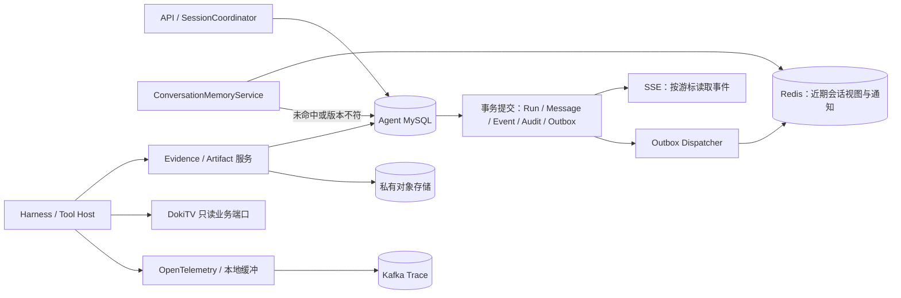
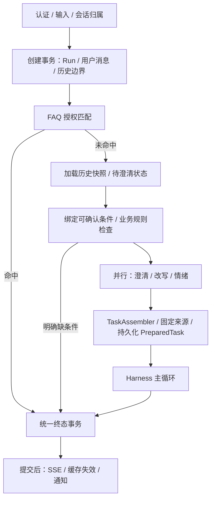

# DokiTV Agent 存储体系设计

日期：2026-10-21，设计背景基于 v0.6。2026-10-22 更新：**v0.7 已接通 MySQL、Redis 近期视图和私有文件对象。本文保留完整目标方案；实际实现、单写实例限制和配置以 [持久化存储接入](持久化存储接入.md) 为准。**

## 1. 方案结论

采用一个 Agent MySQL 库作为正式记录源，Redis 保存可重建的近期会话视图，对象存储保存大结果，Kafka 承载已有 Trace。先保证单实例持久化的正确性，再启用多实例任务租约和恢复。

这与参考材料的关键区别是：对话原文也进入 MySQL，Redis 失效不会造成会话永久丢失；任务状态、最终答复、终态事件和审计可以在同一数据库事务中提交。存储按用途分工，同时明确哪些是正式记录、哪些是派生视图。

首期保留一个 Spring Boot 应用和一个 Agent 数据源。正式接入时，DokiTV 的业务数据通过已有 BusinessQueryPort 只读访问，身份/业务表不复制到 Agent 库。配置表与会话表暂不拆两个物理库，达到实际容量或隔离需求后再拆。

## 2. 数据归属

| 数据 | 正式存储 | Redis 中的用途 | 说明 |
|---|---|---|---|
| 会话归属、状态、顺序、当前任务 | MySQL agent_session | 可选通知 | 所有访问先检查当前身份；缓存键不承担鉴权 |
| 用户消息、最终答复、澄清问题 | MySQL agent_message | 最近若干完整问答的视图 | 不把工具结果加入聊天历史 |
| 每次请求、PreparedTask、终态、租约 | MySQL agent_run | 可选唤醒/取消通知 | runId 表示一次执行；sessionId 表示连续会话 |
| SSE 可重放事件 | MySQL agent_run_event | 可选事件到达通知 | 数据库按 sequence 读取；通知丢失不等于事件丢失 |
| 小型结构化证据与来源 | MySQL agent_evidence | 首期不缓存 | 保存事实、查询指纹、水位、完整性和归属 |
| 大查询结果、报告、附件 | 私有对象存储 | 不存正文 | MySQL agent_artifact 保存对象键、哈希、大小、状态和归属 |
| 待补充条件与已确认条件 | MySQL agent_clarification | 首期不缓存 | 用结构化状态续接，不靠模型猜聊天记录 |
| 重要操作审计 | MySQL agent_audit_event | 不缓存 | 与关键业务变更同事务记录；后续可导出 |
| 异步通知/导出任务 | MySQL agent_outbox | 目标之一 | 事务内登记，事务外投递，允许重试与去重 |
| Trace / Span | 现有磁盘缓冲 → Kafka → 后续查询存储 | 无 | 遥测与任务恢复、不可丢审计分开 |
| Skill / Prompt / Tool 配置 | 目前 classpath 版本文件 | 首期不缓存 | 后续远程化才增加版本清单和对象存储，不先建通用配置中心 |



图中的 Redis、MySQL 双写通过“数据库正式提交 + 派生视图更新”协调，不使用跨 Redis/MySQL 的分布式事务。

## 3. 对参考材料的取舍

保留：历史只含用户与最终助手消息；近期原文与较早摘要分开；当前问题有明确边界；历史字符额度与整个模型输入额度分开；大产物外置。

调整以下假设：

1. **Redis 单线程不等于多命令事务。** HSET、SADD、EXPIRE 分开发送仍可能部分完成。需要按语义使用事务或 Lua；它们也不提供任意运行错误下的自动回滚。脚本须短小并提前校验参数。[Redis 事务](https://redis.io/docs/latest/develop/using-commands/transactions/)、[Lua 脚本](https://redis.io/docs/latest/develop/programmability/eval-intro/)。
2. **“取最近 20 条”不等于 Hash 只有 20 条。** 无界 Hash 的全量读取量由整个会话决定。本项目直接缓存有数量和字节上限的窗口，完整历史由 SQL 分页。
3. **MySQL 可以保存对话。** 按租户、会话、序号建索引，用有界查询取最近消息；是否扩容依据实际执行计划和负载，不能只因每轮 INSERT 就排除。[MySQL ORDER BY 与索引](https://dev.mysql.com/doc/refman/8.4/en/order-by-optimization.html)。
4. **消息顺序用服务端序号。** 时间戳只用于展示；不依赖多实例时钟及 UUID 排序决定对话先后。
5. **类型/标签索引先按实际产品查询建设。** 会话续聊不需要两套 Redis Set。后台标签检索后续使用关系表、组合索引和游标分页，避免全量 SMEMBERS 和过期残留。
6. **跨请求状态按会话、任务归属。** 不使用只有 uid + tenantId 的一个 JSON 覆盖所有会话。保存已确认条件、待补字段和可观察执行状态，不保存模型内部思维链。

Redis 具备 RDB/AOF 等持久化选项，但实际数据丢失窗口取决于配置与故障场景；本方案让近期视图可从 MySQL 重建。[Redis 持久化说明](https://redis.io/docs/latest/operate/oss_and_stack/management/persistence/)。

## 4. 身份、顺序和不可变快照

所有仓储操作使用服务端生成的 StorageScope：tenantId、ownerUserId，以及当前 sessionId/runId。请求不能自行指定可信 owner。读取证据和产物同时校验当前权限，旧 AccessScope 快照只用于追溯，不能当作永久授权。

| 标识 | 作用 |
|---|---|
| sessionId | 一段连续对话，归属于租户和用户 |
| runId | 一次独立执行；澄清后新建 run，不复活已结束任务 |
| turnSeq | 会话内单调递增的轮次，由锁定会话行后分配 |
| messageSeq | 用户消息为 2 × turnSeq − 1，助手消息为 2 × turnSeq；允许失败/取消留下空位 |
| eventSeq | 每个 run 单独从 1 递增，不能与 messageSeq 混用 |
| generation | 会话执行代次；新请求替代旧请求时递增，阻止旧 worker 写入 |
| historyVersion | 可见历史版本；成功答复、澄清、删除等改变历史时递增 |
| leaseToken | 任务执行租约的递增令牌，区分失去租约后仍运行的旧 worker |

PreparedTask 在进 Harness 前固定业务日期、条件来源、资源版本、工具上限和预算。agent_run 保存同一份不可变快照及 schemaVersion。历史、工具观察视图、证据、任务状态分别保存，不能把整份 RunState 序列化成一个大 JSON 作为全部持久化方案。

## 5. 会话记忆：正式消息与模型视图分开

### 5.1 默认窗口

以下是可配置的首期起点，需要真实模型评测后调整：

| 配置 | 建议初值 | 管什么 |
|---|---|---|
| memoryReadMaxMessages | 20 | 最多取 10 个完整、已提交的可见轮次 |
| memoryRecentRawMessages | 8 | 最近 4 个轮次优先保留原文 |
| memoryOlderMaxChars | 4000 | 其余更早消息的确定性摘要额度 |
| memoryMaxChars | 16000 | 组装后全部历史视图的字符上限，不含当前问题 |
| memoryCacheMaxBytes | 262144 | 单会话 Redis 视图序列化后的字节上限 |
| memoryCacheTtl | 24h | 近期视图的缓存寿命，不决定正式消息保留时间 |

20/8 均表示消息数量，不是轮次数量；读取和裁剪以完整问答对为单位。首期每个可见轮次只有一条 USER 和一条 ASSISTANT，适用于 FAQ、普通答案和澄清问题。

失败/取消请求的用户消息保留作界面记录，但不自动作为完整问答塞回模型，也不拼接成“助手已处理”。以后支持多条助手消息时，需要升级窗口投影规则。

最近 8 条原文也可能超过 16000 字符。此时继续从最早完整轮次移除或降为受控摘要，记录 historyTruncated；不能承诺无论消息多长都保留 8 条原文。所有历史读取有数量和字节边界，界面完整历史走独立分页接口。

### 5.2 MemoryBuilder

1. 按 run 捕获的 historyVersion 与 turnSeq 边界，读取当前轮次之前已提交的可见消息。
2. 先按 messageSeq 排序，保留角色、来源消息 ID、数据时间和引用；当前问题单独传递。
3. 更早区域优先抽取已确认对象、日期、任务结论和证据引用；没有可靠结构化摘要时使用有标记的有限摘录。首期不增加一次模型总结调用。
4. 最近区域尽量保留原文；不为凑长度改写数字事实。历史答案不能代替本轮最新查询，也不能凭历史获得权限。
5. 加入 CURRENT_FOCUS_BOUNDARY，再传入本轮用户问题。边界规则放可信模板，历史文本按原角色与不可信来源处理，不提升为 system 指令。

建议边界含义：历史仅用于理解指代与背景；当前问题决定本轮任务；历史中未完成事项不自动续做；旧证据必须检查归属、时效和当前权限。

这个分隔符是聚焦提示，不是提示注入防线。模型适配器必须保留消息边界，工具侧继续执行固定权限与参数检查。

### 5.3 三种额度

- memoryMaxChars：控制历史视图大小，MemoryBuilder 执行。
- 每次模型输入 Token 额度：指令、历史、当前问题、工具 Schema、工具结果、协议开销全部计入，由每次调用前的固定检查保证。
- 全任务累计 Token/金额/调用次数额度：覆盖预处理、主循环和收尾，独立预留与结算；压缩历史不会退还已花费用。

不直接沿用 200000 Token。可用输入额度应取模型实际窗口减去输出预留与安全余量，并与业务设置的更小上限取最小值。当前 v0.6 仅实现调用次数上限，另两类 Token/金额能力仍待开发。

## 6. Redis：首期采用一个有界近期视图

首期每个会话一个 String，值为带版本的 JSON。最近 20 条这种固定小窗口不需要同时引入 Hash、ZSet 和多套 Set 索引。

```text
dokitv:memory:{scopeHash}:recent

scopeHash = SHA-256(按固定格式编码的 tenantId、ownerUserId、sessionId)
value = {
  schemaVersion, sessionEpoch, historyVersion, throughTurnSeq, validUntil,
  turns: [{runId, turnSeq, userMessage, assistantMessage, references}],
  historyTruncated, encodedBytes
}
```

scopeHash 使用规范化编码，避免原始 ID 中分隔符或花括号影响键结构。键是定位符，不能替代 MySQL 会话归属检查。缓存最多 10 个完整轮次；超过字节上限就丢弃最早完整轮次并标记截断。

读取协议：先获取已授权会话及本请求历史边界，再 GET；仅在版本、会话代次、轮次上界和 schema 都匹配且未到 validUntil 时使用。validUntil 不晚于其中最早正式记录的过期时间，Redis TTL 同样取 24h 与该剩余时间的较小值。未命中、版本不符或 Redis 不可用，走 MySQL 有界查询。数据库不可用时不能只凭 Redis 继续鉴权、创建或完成任务。

更新协议：数据库事务提交后，outbox 触发失效或重建。即使失效消息延迟，下一请求读取的版本不同也不会采用旧视图。并发重建须用版本条件写，避免旧重建覆盖新视图；若缓存比本请求快照更新，就从数据库读取本请求边界，不覆盖新缓存。可以使用同一键上的 WATCH/MULTI 或短 Lua 实现条件替换。

缓存过期、重建和异步乱序必须可重复执行。删除会话后，重建者需重新确认会话未删除；即使旧视图残留，也不能绕过归属与删除状态检查被读取。

后续确有长窗口、按消息随机访问需求时，再采用 Hash 正文 + ZSet 顺序索引，并在同一脚本中完成写入、裁剪与过期。跨键脚本需处理 Redis Cluster 同槽限制；跨会话标签索引不能直接塞入这笔原子操作。[Redis Lua 的 Cluster 限制](https://redis.io/docs/latest/develop/programmability/lua-api/)。

## 7. 进入 Harness 前的存储访问顺序



FAQ 先于历史正文读取，但 FAQ 匹配器只允许可独立回答的批准条目；有指代或依赖上下文的输入不得被静态 FAQ 误命中。

历史与待澄清状态可做有界只读加载；在规则和三个预处理任务使用上下文之前必须汇合成同一份不可变快照。不能先对“那昨天呢”做无上下文必填检查，也不能让三个分支各读一次“最新历史”。

显式 replyToRunId 的澄清续接先恢复已确认的结构化条件，再校验用户补充字段。普通追问如“那视频1002呢”可以从本轮和已授权历史提出条件候选，但每个条件需标明来源并验证；有多个可能对象就追问。历史内容不会扩大授权。

准备层不得将旧助手文本直接当成可信任务条件。当前只支持原始单轮问题的解析器需要升级来源契约，此处是下一阶段设计，不代表 v0.6 已支持多轮。

## 8. 事务边界与唯一终态

### 8.1 接收请求

在一个短事务中：校验或创建会话 → 检查 Idempotency-Key → 分配 turnSeq/generation → 建立 run → 保存用户消息 → 分配初始事件序号 → 写审计及必要 outbox。

同一 tenant + owner + Idempotency-Key 仅对应一个 run，存规范化请求指纹。相同 key、相同内容返回原任务；相同 key、不同内容返回 409。没有 key 则每次 POST 都是新请求。Key 保留期限与任务一致，不能承诺永久去重。

当 sessionId 省略时，同样先按身份与幂等键寻找已有请求，避免重试创建多个会话；唯一索引竞争失败必须回滚整笔创建事务，再读取已存在的 run。

持久化 QUEUED run 是待执行任务的依据。进程内入队失败不能让任务永久悬空：持久化模式由扫描/分发器重新领取；队列只是本地加速，不能继续沿用“Map 是唯一记录”的模式。

### 8.2 执行期间

数据库锁只保护短事务，不跨模型或工具网络调用持有。领取任务记录 leaseOwner、leaseToken、leaseUntil；续租、写进度、登记证据都检查有效租约、run 状态、session generation。模型调用期间可由独立心跳续租，业务提交仍重新校验。

首期同一会话只有一个活跃任务。建议聊天模式采用“新消息取代旧任务”：新请求在同一事务内递增 generation，将旧 run 转为 SUPERSEDED 并记录 ABORT/DONE，再登记新 run。重试相同幂等键必须先返回旧结果，不能误打断任务。需要并行分析时使用不同会话。

Redis 通知可加快旧实例停止，但数据库 generation/leaseToken 才决定它能否继续写入。旧 worker 未收到通知、忽略中断或在租约丢失后返回，也不能提交答案。

### 8.3 最终交付

DeliveryService 完成治理与答案/证据验证后，由 TerminalCommitter 执行一笔数据库事务，统一锁顺序为 session → run → 子记录：

1. 检查当前终态竞争、租约、generation、任务版本、总截止时间与证据 READY 状态。
2. 正常结束更新 run；取消/失败使用对应受控入口。只有一个提交方能从活动态变为终态。
3. SUCCEEDED 或 NEEDS_INPUT 时插入助手消息，标记该轮可进入历史；递增 historyVersion。
4. 同事务追加 ANSWER/CLARIFICATION/ERROR/ABORT 和唯一 DONE，更新 lastEventSeq；写审计和 outbox。
5. 提交后再唤醒 SSE、更新进程内快照、通知缓存。不等 Kafka 或 Redis 成功才完成这笔业务事务。

进程内 CAS 仍可减少本地竞争，但数据库提交结果才是持久化模式的最终依据。不能在现有 RunState 先发布成功之后，用异步 Observer 补写数据库；那样可能客户端看到成功、数据库却没有结果。

消息正文与 run 的输入快照、SSE 的答案投影存在有意冗余：同事务生成、只读引用、标明来源和版本，不允许各自独立修改。持久化成功不等于客户端恰好收到一次；重连仍按 eventSeq 去重。

## 9. 核心表与索引

DDL 草案：[storage-schema.sql](storage-schema.sql)。以 MySQL 8.0.16+ 的 InnoDB / CHECK 能力为语法基线；部署版本还需按实际环境验证。事务与读取样例见 [storage-queries.sql](storage-queries.sql)，其中命名参数与分支处理需由应用实现。

| 表 | 关键字段与约束 | 主要访问路径 |
|---|---|---|
| agent_session | tenant/owner/session、nextTurnSeq、generation、historyVersion、currentRunId、version | 按拥有者列会话；锁定会话分配顺序 |
| agent_run | session/turn、请求指纹、幂等键、PreparedTask、状态、leaseToken、lastEventSeq | 唯一幂等；按会话取最新可见轮次；领取过期租约 |
| agent_message | run、role、messageSeq、content、引用 | 每 run 每角色唯一；按会话序号分页 |
| agent_run_event | run、eventSeq、type、payload、doneMarker | 主键保证事件序号唯一；唯一 doneMarker 防重复 DONE |
| agent_artifact | objectKey、sha256、size、mediaType、状态、期限 | 对象归属查询与垃圾回收 |
| agent_evidence | run、查询指纹、事实快照、来源、可选 rawArtifactId | 证据按当前 run 与拥有者读取 |
| agent_clarification | 原 run、已确认字段、缺失字段、期限、resumedByRunId | 同会话内 CAS 一次续接 |
| agent_audit_event | eventId、actor、action、subject、脱敏属性 | 租户/时间/任务查询；不存完整问题和模型输出 |
| agent_outbox | eventId、destination、状态、重试、claimToken、leaseUntil | 唯一事件/目标；到期批量领取 |

近期历史先用 run 的 (tenant, session, historyVisible, turnSeq) 索引取最近 10 个轮次，再读取对应消息；避免在大量取消记录中逐条过滤。会话列表、消息列表和事件重放使用游标分页，不使用不断增长的 OFFSET。

首期不分表、不分配置库。先记录行数、正文平均大小、写入速率、数据库延迟和索引命中；读写分离、归档或分区必须保持顺序、唯一约束与读后写一致性。

### 9.1 按能力增加配置与账本，首期不复制整套广告表

- FAQ 动态化时增加条目、不可变修订、发布状态及可见范围。检索只提出候选 ID，交付前查询当前已发布版本和权限；不能只相信检索索引里的旧答案。现有 classpath FAQ 仍可作为 demo 适配器。
- RAG 上线时再定义知识文档/修订、分类关联、访问策略与检索索引映射。向量或关键词索引用于召回，不作为授权和原文的唯一记录；引用需包含文档版本、来源位置、有效期与当前可见性。首期没有 RAG，不先建设向量数据库。
- 远程 Skill/Prompt 增加 resourceRevision 清单：resourceId、version、sha256、objectKey、schemaVersion、发布/撤销状态。PreparedTask 固定该修订；变更的模型输出约束、工具集合仍由固定边界验证。密钥使用环境或凭证服务，不写进资源元数据或会话快照。
- 完整预算增加独立 modelCallLedger：callId、runId、阶段、step、模型、调用状态、预留额、实际输入/输出 Token、用量已知/未知、金额/币种、价格版本、提供商请求 ID。请求前持久化预留，结束后幂等结算；超时或崩溃导致用量未知不能按零元入账。最终模型调用和三个预处理调用均纳入账本，不能事后只从 Trace 汇总费用。

这些是后续逻辑模型，不在九表草案中，也不表示当前实现了发布平台、RAG 或费用结算。资源和配置按用途建表，避免用一个无限扩展的 key/value 配置表承担所有业务。

## 10. 证据和对象存储

小型 MetricData 连同查询条件、统计口径、dataAsOf、timezone、complete、demo 写入 agent_evidence，保存内容哈希和 schemaVersion。模型看到的压缩视图不是原始证据。重复执行工具产生的证据可按调用 ID/幂等策略复用，不能只按参数永久缓存动态结果。

大结果走以下过程：

1. 在数据库登记有归属的 PENDING artifact，分配不可变 objectKey。
2. 上传到私有桶并验证长度/哈希；不要覆盖旧对象键。
3. 检查有效租约后，在短事务中标记 READY 并登记可引用证据/产物。
4. 只有 READY 对象可进入答案。上传后数据库失败留下的对象由宽限期后的 GC 清理；上传前失败的 PENDING 也要清理。

不能假设 MySQL 与对象上传原子提交。对象写超时的结果可能未知，恢复任务应按确定对象键核对，不能盲目重复生成报告。读取使用 artifactId → 当前鉴权 → 受控下载或短时签名 URL；数据库保存 objectKey，不保存长期公开链接或会过期的签名 URL。

首期不建设短链表。后续需要分享时单独定义分享范围、到期、撤销与访问记录，短码不自动意味着公开权限。

## 11. 澄清续接、检查点与恢复

NEEDS_INPUT 是已结束的 run。agent_clarification 保存原问题、已确认条件及来源、缺失字段、schemaVersion、baseHistoryVersion、expiresAt；不保存模型推理正文。

新请求传 sessionId + replyToRunId，经归属、期限、状态和条件校验后，以 CAS 将 OPEN 改为 RESUMED 并记录 resumedByRunId。续接状态变更与新 run 创建同事务完成。相同幂等请求返回同一新 run；其他请求重复消费返回冲突或要求重新明确条件。

继续的是业务任务信息，不是复用旧 run 的截止时间、租约或已花预算。新 PreparedTask 标明哪些条件来自原请求，哪些来自本轮补充；重新鉴权。

首期故障恢复规则：

- 已持久化但未执行的 QUEUED 请求可以重新领取。
- RUNNING 租约过期时先阻止旧 worker 写入，再持久化 RUNNER_LOST 失败；**尚未建设执行检查点时不自动从中间重跑。**
- SUCCEEDED/NEEDS_INPUT 不重新调用模型；直接返回已提交结果。
- 新消息替代、用户取消、总超时都形成持久化终态和事件。

以后增加检查点，应记录 step、调用 ID、参数指纹、可观察结果引用、预算结算状态、资源版本等业务状态。外部模型计费和未来写工具不能因“恢复”而无条件重放。跨实例唯一提交也不等于外部副作用恰好一次。

## 12. SSE、Outbox、Trace 与审计

SSE 的序号来自数据库，重连读取 sequence > Last-Event-ID，按序发送。Redis Pub/Sub 或本地通知仅用于减少轮询延迟，不能作为唯一事件源。请求完成后仍可按保留期重放。

终态与 DONE 同事务追加；普通进度事件也校验状态和租约，终态后拒绝追加。一次 run 的事件数量/总字节设置上限并预留终态空间，不逐 Token 落库。事件过期后返回明确 EVENTS_EXPIRED，并引导读取最终 Snapshot；不返回一个悄悄缺事件的“完整回放”。

Outbox Dispatcher 用短事务领取到期记录，提交后再发送；成功回写需匹配 claimToken，失败退避重试。允许至少一次投递，消费者按 eventId 去重；通知乱序时 SSE 仍以数据库 sequence 为准。持续失败进入 DEAD 并告警，人工或受控任务可重驱，不静默丢弃。

可用 FOR UPDATE SKIP LOCKED 分摊 outbox 队列领取，不能把它用于需要完整一致视图的历史/权限查询。[MySQL 锁定读取](https://dev.mysql.com/doc/refman/8.4/en/innodb-locking-reads.html)。

Trace 保留当前 OTel → 磁盘缓冲 → Kafka，继续按 traceId 关联，用 parentSpanId、时间和事件字段重建链路。Kafka 分区记录顺序不等于并行操作的开始顺序；默认按 key 哈希的策略也不能推导出扩分区后映射永远不变。因此诊断查询仍需基于标识、时间和父子关系排序，不能只依赖分区顺序。生产者的重试与顺序配置继续按现有幂等设置验证。[Kafka 生产者配置](https://kafka.apache.org/36/configuration/producer-configs/)。

重要审计在创建、终态、拒绝、受控证据/产物访问和管理变更时落 MySQL。审计写入失败则对应受保护操作失败并回滚；Trace 导出故障按现有隔离策略处理。审计只保留必要元数据，不把完整用户问题、提示词、响应和凭证拷贝过去。应用角色限制更新/删除权限，但普通表本身不构成防篡改存储。

## 13. 生命周期、删除与降级

这些是待评估的工程初值，不代表合规要求或永久承诺：

| 数据 | 建议初值 | 删除/过期规则 |
|---|---|---|
| 会话档案 | 最后活动后 30 天 | 新消息只续会话档案，不批量续所有旧记录 |
| 正式消息、run | run 结束后 30 天 | 创建时先设置期限，结束事务统一更新该 run 及所属记录；过期轮次成组清理 |
| 近期 Redis 视图 | 24h | 可重建；访问不自动延长正式记录寿命 |
| SSE 事件 | 每 run 创建后 7 天 | 过期标识留在 run；保留最终 Snapshot |
| 证据 | 与所属 run 一致 | 引用不存在或超期时明确返回，不伪造零值 |
| 产物 | 通常与所属 run 一致 | 下载链接不得长于实际有效期；提前过期需明确提示 |
| 待澄清状态 | 24h，且不晚于所属 run 期限 | 过期需重新确认任务 |
| 审计 / Trace | 分别暂定 90 天 / 7 天 | 业务确认后配置；审计长期保留须最小化个人数据 |
| 已发送 outbox | 暂定 7 天 | 只有确认投递后的记录才清理；未发送记录受配额和告警治理 |

会话删除先在事务中标记 DELETING、递增 generation/historyVersion，阻止读取和新执行、终止活跃任务，再异步删除对象、失效缓存、清理数据库子记录。运行中的父任务租约检查包含会话删除状态。清理顺序遵守 FK，保留删除任务的幂等状态；待上传对象和延迟缓存重建必须识别已删除会话，避免数据复活。普通保留期清理按完整 run 清理，改变可见历史时同步递增 historyVersion，不能先单独删掉问答的一半。

对象下载链路每次重新鉴权；已签发 URL 的撤销窗口取决于有效期，敏感对象需要代理下载。备份、副本和日志中的删除由单独保留策略处理，不能把在线 DELETE 等同于所有副本立即擦除。

| 故障 | 行为 |
|---|---|
| Redis 不可用 | 在读配额内回源 MySQL，缓存恢复后重建 |
| MySQL 不可用 | 拒绝新任务和受保护交付；客户端可重试相同幂等键 |
| 提交结果未知 | 按 run/幂等键重新查询确认；不立即重跑模型 |
| 对象存储不可用 | 小型指标不受影响；依赖大产物的任务明确失败或等待受控重试 |
| Kafka 不可用 | Trace 继续当前有界缓冲/隔离；业务审计保留在事务记录中 |
| outbox 积压 | 告警、限制扩张、受控重试；SSE 可降级轮询数据库 |
| worker 崩溃 | 租约到期后按恢复规则处理，晚到写入被拒绝 |

保留期清理和高吞吐数据表备份恢复都需演练。吞吐、RPO/RTO 不能靠表结构或组件名称推定。

## 14. 接口与目录演进

| 建议端口/服务 | 责任 |
|---|---|
| SessionRepository / SessionCoordinator | 归属、轮次、单活跃策略、历史版本、删除 |
| RunRepository / RunLeaseRepository | 幂等创建、领取、续租、状态与快照 |
| MessageRepository / ConversationMemoryService | 正式消息、有限快照、缓存回源 |
| MemoryBuilder | 历史的模型视图，独立于数据库实现 |
| TerminalCommitter | 跨 run/message/event/audit/outbox 的统一事务用例 |
| EvidenceRepository / ArtifactRepository / ObjectStore | 证据、对象生命周期与授权读取 |
| ClarificationRepository | 结构化条件、期限与一次续接 |
| AuditWriter / OutboxRepository | 事务内记录与事务外投递 |

已有 EvidenceStore、RunEventStore 需要适配，不宜只逐个方法加 @Transactional：现有 RunState 仍自己构造内存实现并先发布终态。持久化模式必须引入明确装配工厂和统一工作单元，提交后再更新内存投影。

建议新增 adapters/storage/mysql、adapters/storage/redis、adapters/storage/object 目录，业务用例依赖内层端口；MyBatis/JDBC/Redis 客户端和对象存储 SDK 不进入 core 或 Hook。MyBatis-Plus 可用于普通 CRUD，但领取、条件更新、事务提交和分页需要明确 SQL。动态数据源切换不是首期必需。

Memory / persistence profile 必须显式选择；正式环境 MySQL 故障不能退回内存并返回假成功。新增 sessionId/replyToRunId/Idempotency-Key 属于下一版 API，当前 HTTP 契约不因本设计自动改变。

## 15. 实施与验收

| 阶段 | 交付 | 验收 |
|---|---|---|
| A：正式任务记录 | MySQL 会话/run/消息/事件/证据；统一终态事务、幂等、审计/outbox | 重启仍可查结果；并发终态只有一次；重试不重复创建 |
| B：连续会话 | MemoryBuilder、窗口缓存、澄清续接 | 当前问题聚焦；快照不串轮；Redis 清空/故障可回源；补充条件不越权 |
| C：大结果 | Artifact/ObjectStore、模型视图、对象 GC | 过大结果不上下文；上传/提交各故障点可清理；无跨用户读取 |
| D：多实例与恢复 | 租约、generation、过期扫描、持久化取消通知 | 旧 worker 无法写入；新消息打断不误伤新 run；故障后行为可解释 |
| E：完整预算和远程资源 | 独立调用账本、版本清单、资源生命周期 | 失败用量记未知；预处理/主循环/收尾可对账；运行中版本固定 |

存储测试需使用目标 MySQL/Redis/对象存储的真实协议，覆盖事务回滚、并发竞争、重复 outbox、乱序失效、缓存版本、对象半成功、过期删除、授权收缩和租约丢失；不能用 H2 代替验证 MySQL 的锁与唯一约束语义。

本设计的早期静态检查为九表、八组外键一致性检查。v0.7 随后已执行独立的 Flyway V1 迁移并完成真实 MySQL/Redis 和私有文件对象验证；docs/storage-schema.sql 仍是评审草案。多实例、S3、完整预算等目标不属于已经完成的能力，实际范围见《持久化存储接入》。
