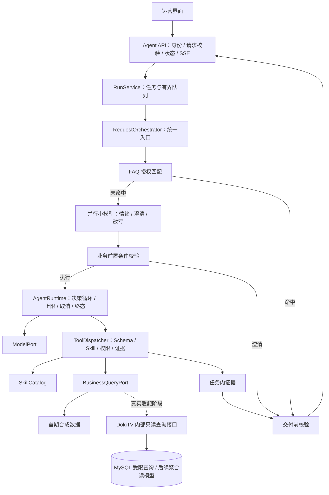

# DokiTV 运营 Agent：首期架构与协作方案

2026-10-21：v0.4 已补统一入口、FAQ、并行预处理、真实 DeepSeek 适配与循环控制。当前状态见《项目进度》，入口及模型契约见《统一入口与并行预处理》《DeepSeek模型接入》。下文保留首期业务边界与协作安排。

## 1. 项目目标与首期范围

让运营人员用自然语言查询 DokiTV 视频互动数据，得到有统计口径、数据时间与证据引用的答案。
先交付可复现的单视频指标查询，再增加双视频对比和报告。Agent 对业务只读。

当前 DokiTV 是点播视频后端，房间按视频 ID 分组。首期使用 video_id，不引入尚未存在的主播、直播场次与租户业务模型。
代码保留 tenantId 作为权限契约字段；演示值为 demo，接真实数据前需要定义它与 DokiTV 身份/资源的映射。

第一期真实能力建议限定为：按视频 ID、自然日期查询弹幕发送数量。没有观众曝光/观看事件时，不提供 UV、留存、完播率或互动率。
累计 view_count 不能直接当作某日播放次数或独立观看人数。

## 2. 对原方案的关键调整

| 原设计中的问题或未定项 | 首期决定 | 后续触发条件 |
|---|---|---|
| 数据、编排、治理画在一张流程图里，职责容易交叉 | 分为业务查询边界、Agent Runtime、交付接口三个模块 | 再按独立扩容需求拆服务 |
| 全量并行情绪、意图、槽位、记忆等预处理 | 先用一次结构化任务理解；按实际需要再检索 | 评测证明独立步骤带来收益 |
| 所有复杂任务进入自由循环，难以验收 | 固定示例任务验收 Loop，后续优先用明确查询/对比工作流 | 工作流无法覆盖的探索任务再开放规划 |
| Q&A 数据缓存置于完整任务理解之前 | 暂不实现；先解析视频、绝对日期、口径与范围，再设计数据缓存 | 有稳定高频重复问题 |
| “只读副本/聚合读模型”未定义生产者和时间语义 | 先做只读查询适配，明确事件时间、删除规则与更新延迟 | SQL 性能达到瓶颈再建增量聚合 |
| Redis ZSet 被同时当作回看缓存与分析源 | 回看缓存维持原用途；分析使用有完整性说明的查询服务 | 缓存过期与 playback_time 不能代表发送自然日期 |
| 全部治理通过 Hook 表达，强制检查与插件边界不明 | 权限、参数、结果归属、终态控制固定在执行链路中 | Hook 用于观测等扩展，不能绕开固定校验 |
| Tool/Skill 能力交集缺少具体实现 | 全局三工具 + 当前 Skill 工具目录；服务端再次校验 | 增加用户级能力授权时扩展策略组件 |
| SSE 输出与交付校验存在先后冲突 | 进度先发；答案通过校验后整段发 ANSWER | 真正流式答案需定义段级校验或草稿协议 |
| Trace 被赋予全部审计职责 | v0.2 已接 OpenTelemetry、Hook 和 Kafka 可选出口；正式审计仍独立持久化 | Trace 容量故障可丢新记录，审计不能依赖这条弱保证 |

## 3. 逻辑架构

物理部署先保持两个应用：已有 DokiTV 与新建 operations-agent。
代码按功能分包，不在首期拆网关、记忆、工具、Skill 等独立微服务。
后台 Worker 先在 Agent 应用进程内运行，任务存储与队列的持久化属于下一阶段。

## 4. 必须冻结的契约

1. `ModelPort.decide(ModelContext)`：返回工具调用、澄清或带证据的答案。模型不能直接执行工具。
2. `BusinessQueryPort.query(MetricQuery, AccessScope)`：业务数据唯一边界，权限上下文由服务端传入。
3. `IdentityPort.authenticate(credential)`：验证身份并返回资源范围，不能相信请求或模型给出的租户/用户范围。
4. `ToolDefinition`、`ToolResult`、`Evidence`：Schema、统计口径与结果归属由共享契约定义。
5. HTTP / SSE：以《接口契约》为准；改字段前先更新文档和契约测试。

接口需要调整时，先提交契约 PR，由总负责人确认，再让各模块跟进；不要求每次内部实现调整都协调全组。

## 5. 人员分工与验收

下列是工作包，不要求一人一包；人数少时可合并。建议你负责公共契约、Runtime 合并与端到端验收。

| 工作包 | 主要目录或仓库 | 交付物 | 最小验收 |
|---|---|---|---|
| 你：总负责人 / Runtime | core、runtime、tool、skill、文档 | 保持闭环、评审公共契约、接入模块 | 演示用例全通过；越权/取消/失败不交付答案 |
| 同学 A：真实模型适配 | model 下新增 provider 包 | 一个真实 ModelPort；配置外置；结构化决策解析；连接与读取超时 | 能动态 read_skill、查工具、回答；非法 JSON/超时有明确失败；测试使用假 HTTP 服务 |
| 同学 B：业务查询 | query 下新增 dokitv 包；DokiTV 新增只读接口 | 指标定义、SQL/服务接口、身份映射、数据质量元信息 | 对固定测试集，按日期/视频数量与 SQL 对账；拒绝越权视频；区分数据缺失和零 |
| 同学 C：运营前端 | 新建前端工程，首期不限制框架 | 提问、进度、答案、证据、澄清、取消与重连 | 使用演示后端完成全流程；Bearer 通过 fetch 流读取 SSE；不会展示失败任务的假成功 |
| 同学 D 或轮值：测试与集成 | 测试、样例数据、CI、Trace 后端集成 | 场景集、契约测试、日志规范、集成启动说明 | 无凭证提交；CI 可复现；每个终态有测试；敏感内容不进普通日志 |

每个工作包独立分支和 PR。`core` 由总负责人统一维护，减少并行修改公共文件的冲突。
单独运行 demo 不需要对其他同学开发中的模块建立依赖。

## 6. 第一轮里程碑

- M0 基架交付：本工程，离线演示、接口契约、边界测试可运行。
- M1 真模型：使用演示查询数据验证真实模型调用与工具选择，仍明确标注模拟数据。
- M2 真查询：DokiTV 测试环境的真实只读指标，统一身份与数据范围；不能直接沿用 demo 凭证。
- M3 运营界面：完成从提问到证据查看、澄清后新建任务、断线回放与取消。
- M4 联调验收：固定问题集、正确性、超时、并发与资源边界；达到后再加对比、RAG、报告。

M1、M2、M3 可在 M0 契约上并行实施，不要求等待其他工作包完成。

## 7. DokiTV 查询接口建议

先定义 `video.bullet_count.v1`：某视频在北京时间 `[date 00:00, date+1 00:00)` 的弹幕发送事件数量。
必须明确使用“发送时间”，不能用播放器中的 playback_time。确认数据库是否保留对应时间字段和删除记录后，才能定真实 SQL。

决定删除后指标是否回撤：如果只统计当前可见弹幕，应该另用 `visible_bullet_count`；不能与发送事件数混用。
只读副本或聚合表返回 `dataAsOf`、完整性和来源；延迟过大时回答需说明，不能只返回查询执行时间。
首期不自动故障切换到主库进行大范围扫描。同步失败应返回“数据不可用”，不能返回 0。

## 8. 第二期再做的能力

持久化 Run / Evidence / 事件、工具超时与取消传播、受控重试和恢复；调用费用与 Token 预算；可信缓存；
Trace 后端可视化与可靠审计；固定对比工作流；RAG；受控报告渲染。Shell、长期记忆与多 Agent 不进入首期依赖。

v0.2 的 Hook 和 Trace 已落地，详见《Harness-Trace与Hook设计》；不再作为“未开始”的工作包分配。
v0.3 又补充了七类类型化变换链及准入/不变量检查，详见《Hook变换链设计》；新的治理策略可以作为独立 Hook 工作包开发。

后续恢复执行必须考虑工具幂等与任务执行权，不能从最后一条 SSE 事件盲目重跑。
报告生成后再增加 ARTIFACT_READY，只有产物可读取且校验通过才发送。

## 9. 评测与协作要求

固定场景至少包含：合法查询、缺少日期、错日期、零数据、数据缺失、越权、模型超时、重复调用、伪造证据、
取消、重连、后台任务失败。真实模型还要增加弹幕样本中的提示注入测试。

以真实数据对账正确率、任务成功率、越权拦截、p95 时延、工具调用次数和单任务费用衡量迭代。
先记录基线，再共同设目标值，避免凭空宣称高并发或高准确率。

公共文档随代码更新，PR 描述写明接口变化、验证方法和剩余限制。
PR 大小按可评审的一个功能划分，不一次提交一整套模型/数据/前端改造。

## 参考

工作流与自主 Agent 的取舍参考 [Anthropic 工程说明](https://www.anthropic.com/engineering/building-effective-agents)；
权限和工具边界参考 [OWASP Excessive Agency](https://owasp.github.io/www-project-top-10-for-large-language-model-applications/2_0_vulns/LLM06_ExcessiveAgency.html)。
这些资料用于解释设计取舍；本工程是否实现相应能力，以源码与测试为准。
