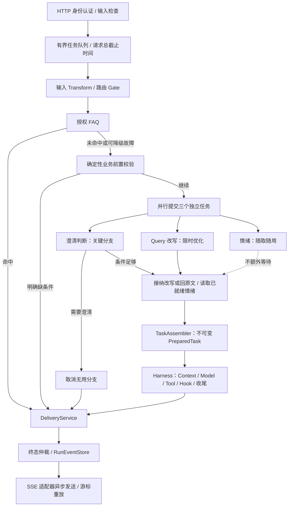

# 统一入口与 Harness 前置流水线

更新：v0.6 流程说明；2026-10-22 的 v0.7 已增加 FAQ 未命中后的历史快照加载和显式澄清续接，见 [持久化存储接入](持久化存储接入.md)。保留单个 Spring Boot 部署单元，先稳定请求契约和执行边界。

## 请求顺序

所有问题提交 `POST /api/agent/runs`，请求仍为 `{"message":"..."}`，创建响应统一 202。FAQ 直接回答表示跳过模型与工具循环，答案仍从任务状态或 SSE 获取。

## 串行与并行的理由

| 步骤 | 执行方式 | 原因 |
|---|---|---|
| 认证、输入检查、输入 Hook、路由治理 | 串行，先于后续业务 | 先得到可信范围与可接纳输入 |
| FAQ | 先查、限时等待 | 命中时省掉所有模型调用；只接受已批准且授权的条目 |
| QueryReadinessPolicy 列表 | FAQ 未命中后串行 | 明确缺日期等条件可以直接追问，避免模型开销 |
| 澄清、改写、情绪 | 同一份规范化原始输入，并行提交 | 三者没有数据依赖；不让改写补造条件后再判断是否缺条件 |
| 结果汇合 | 先等澄清，再限时取改写，情绪只取已完成结果 | 澄清决定能否执行；改写可回退；情绪不单独阻塞入口 |
| TaskAssembler | 汇合校验完成后串行 | 固定同一份可信执行契约再进循环 |
| Harness、最终交付 | 由循环和统一交付服务控制 | 所有来源共用交付治理与终态竞争 |

需要追问时马上返回 NEEDS_INPUT，并取消尚未完成的改写和情绪。条件足够时，改写若未在自身期限内完成就回原文；情绪未就绪则 UNKNOWN 并跳过。三个模型的提交是并行的，读取结果具有优先级。

粗略关键路径是：认证与排队 + FAQ + 规则 + max(澄清耗时, 接纳改写耗时) + 组装。情绪不单独增加等待。澄清要求追问时不等待改写。该公式不包含执行器过载、调度和框架开销，不是延迟承诺。

## 截止时间与失败语义

| 阶段 | 默认 demo | demo,deepseek | 故障或未就绪处理 |
|---|---|---|---|
| FAQ | 300ms | 300ms | 普通故障记 degradedStages.faq，继续规则 |
| 澄清 | 2s 并行阶段上限 | 10s | 超时、不可解析或普通故障时追问，不猜条件 |
| 改写 | 1500ms，且不超过阶段上限 | 8s | 回到规范化原文，记录 rewrite 降级 |
| 情绪 | 300ms，且不超过阶段上限 | 3s | 汇合时仍未完成则 UNKNOWN，记录 skippedStages.emotion；不额外等满该时间 |
| 请求总时限 | 从创建起 30s | 从创建起 120s | 统一取消，终态不可被晚到结果覆盖 |

阶段截止时间从提交前计算，包含分支排队时间。适配器收到 CallControl，需落实网络截止时间与取消。Future 中断无法强制停止不合作的客户端，也不能保证提供商不计费。

普通适配器故障允许按上表降级。AgentException 表达权限、预算、策略等硬拒绝，通过统一终态仲裁结束请求，不作为普通网络故障忽略。用户取消、总超时会通知所有子分支；晚到结果不能交付第二次答案。

skippedStages 表示未使用或不需要等待的阶段，degradedStages 表示已观测的可用性故障或输出校验失败。FAQ 命中、规则直接澄清时三个模型均跳过。需要澄清时改写不再使用。模型调用是否已经开始，另由 preparationCalls 记录。

## PreparedTask 与条件保护

PreparedRequest 保留原文、执行 Query、情绪、降级及跳过标记。只有 HARNESS 路由才组装 PreparedTask，包含：

- runId、原始问题、执行 Query、预处理结果。
- 请求创建时捕获的 Asia/Shanghai 业务日期；“昨天”在所有轮次里含义一致。
- 结构化 Specification：任务类型、条件、条件来源。
- 身份范围、允许的工具上限、请求截止时间、全链路模型调用次数上限。
- 启动资源快照的 Skill / Prompt 声明版本和工具描述 SHA-256。

Query 改写先检查长度、数字序列和时间/指标词，再通过同一套 TaskMeaning 解析器比较已知结构化条件。当前 MetricTaskSpecificationResolver 识别单视频、弹幕、昨天或单个 ISO 日期；无法识别的任务标记 unclassified，不能宣称完成通用语义等价验证。其他业务实现 TaskSpecificationResolver 注册即可；多个解析器同时声明匹配会拒绝，不以注册顺序猜测语义。

任务条件从用户原始问题固定，工具的 metric 查询仍检查视频范围、日期、指标及结果一致性。固定任务范围不代表支持动态撤权；真实 BusinessQueryPort 必须接入业务端的当前授权检查，后续增加统一权限端口。

## 工程边界

| 组件 | 职责 |
|---|---|
| RequestOrchestrator | 请求用例协调；目前保留 runtime 包位置以兼容既有调用 |
| PreparationService | 有界执行、截止时间、分支取消与结果选择 |
| QueryReadinessPolicy / TaskSpecificationResolver | 业务必填检查 / 已知任务语义解析 |
| TaskAssembler | 固定任务与资源快照，不调用模型 |
| DeliveryService | FAQ / 澄清 / Agent 答案共用交付 Hook 和终态提交 |
| RunState / ExecutionState | 终态与取消 / Skill、观察结果及证据存储 |
| EvidenceStore / RunEventStore | 当前使用的存储端口，首期为进程内实现 |
| SseEventStreams | 订阅、异步发送、游标重放、连接清理 |
| ToolContext | 受限能力接口；不暴露 RunState、终态、SSE、完整 Harness |

工具返回 ToolResult，由 Runtime 决定继续还是交付。只有显式声明 canActivateSkills 的工具可通过上下文激活 Skill。Java 插件仍是可信代码扩展，这个接口不构成不可信代码沙箱。

预处理执行池 6 线程 / 48 队列位，SSE 使用独立 4 线程 / 128 队列位，最多 64 个订阅。慢网络发送不在任务状态锁或 Agent 执行线程中。终态事件和 DONE 在事件存储中一次追加，通知仅负责调度发送。客户端仍需按序号去重，网络层不承诺恰好一次收到。

max-model-calls 默认 16，涵盖已经启动的预处理调用、主循环、收尾；FAQ 和规则检查不计模型调用。Snapshot 保持 modelCalls 为主循环计数，新增 preparationCalls 与 totalModelCalls。预算耗尽为 MODEL_CALL_BUDGET_EXCEEDED。这是请求内尝试次数上限，不是 Token、金额或提供商结算账本。

## 当前边界与下一步

默认 demo 是本地脚本与模拟指标 128；demo,deepseek 可使用同一 Key、不同模型。原有 Hook、OpenTelemetry 与 Kafka/file Trace 出口保留；Trace 增加跳过数和全链路调用计数，正文仍不导出。

v0.7 默认 demo 使用内存，persistent profile 使用 MySQL/Redis/私有文件对象。已实现请求幂等、单视频条件的显式澄清续接、正式消息和审计、重启查询；多实例写入、执行检查点、动态配置、热更新、Token/费用结算和 SSE 心跳仍未实现。
