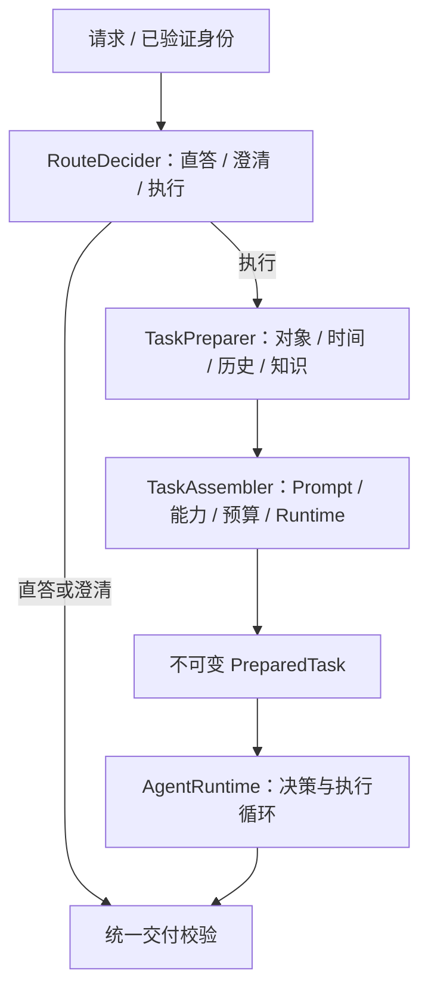

# 请求准备与任务包：参考材料吸收方案

## 状态与适用范围

本文吸收用户提供的“路由 → 准备 → 组装 → Agent 循环”材料，作为下一阶段设计输入。
**这是设计补充，尚未实现下文的新接口、任务包、历史管理、报告或取消适配。**
现有 v0.2 已实现的范围仍以《Harness-Trace与Hook设计》和验证记录为准，本次没有修改运行时代码。
后续 v0.3 已补充类型化 Hook 变换链与结果准入上限，见《Hook变换链设计》；本文的 PreparedTask、会话、ResultRef 和报告仍未实现。
材料中“8 层 Prompt”“8 类工具”和状态外置细节不可见，不推测其实际实现，也不照搬数量或内部产品名称。

## 一、吸收的主结构

Trace / Hook 从路由前开始，覆盖直答、澄清和执行三个分支。
循环不承担入口检索、历史读取、Prompt 拼装、授权合并等所有准备职责。
阶段是逻辑模块，首期保留同一个 Spring Boot 应用。

## 二、建议冻结的接口（待实现）

| 接口 | 输入与输出 | 责任 |
|---|---|---|
| RouteDecider | RequestContext → RouteDecision | 选择直答、澄清或执行，记录依据与策略版本 |
| TaskPreparer | RequestContext + ExecuteDecision → TaskPreparation | 解析对象/绝对日期/口径，按权限读取必要历史和知识 |
| TaskAssembler | TaskPreparation → PreparedTask | 固定指令层次、工具授权范围、上下文预算、Runtime 配置 |
| ConversationStore | 可信 Scope + conversationId → 消息 | 验证会话归属，读取或写入有角色及工具关联的结构化消息 |
| ToolResultAdmission | 原始工具结果 → 有界结果摘要 + ResultRef | 所有工具结果进入模型前做裁剪、脱敏、预算检查和引用登记 |
| ArtifactService | 结构化渲染请求 → ArtifactRef | 服务端生成/存储报告，维护版本和 READY 状态 |
| DeliveryService | Answer / ArtifactRef → DeliveryOutcome | 统一检查归属、证据与产物状态，返回显式终止结果 |

PreparedTask 建议使用不可变类型，包含：

- runId、conversationId、请求版本与原始消息引用。
- TaskSpec：任务类型、videoId、绝对时间范围、时区、指标口径版本、缺失字段、信息来源。
- PromptBundle：稳定角色、业务规则、任务事实、引用内容，各层的版本和来源标签。
- Messages：system / user / assistant / tool 的结构化消息，保留 tool_call_id 关联。
- CapabilitySnapshot：可见工具 Schema、Skill 目录版本、已授权能力和策略版本。
- ExecutionPolicy：Runtime 类型、步数/时间/Token 预算、取消与断线策略。
- 服务端 ExecutionContext：不可变权限范围、Trace Context、取消令牌、结果存储引用。

服务端 ExecutionContext 不整体序列化给模型；模型只接收允许披露的任务事实、消息和工具能力。
Trace、权限、取消、消息历史分别有自己的契约，避免扩成一个任何模块都能修改的 Context Map。

## 三、与当前基架的差异

| 当前实现 | 后续调整 |
|---|---|
| PRE_ROUTE 对应一个简单阶段，没有真正分流 | 引入 RouteDecision；不能把已有 Hook 名称当作路由功能已经实现 |
| ModelContext 主要是问题、Skill 与工具观察结果 | 增加版本化 PromptBundle 和结构化消息历史，保留工具调用关联 |
| 每轮重新组装轻量 ModelContext | 循环输入基于 PreparedTask，再附加受控的本轮增量 |
| 工具字段与权限检查固定在执行链路 | 保留这些强制检查，TaskAssembler 的能力过滤只做前置缩小 |
| Hook 只接收元信息且不可变 | 保持观察/拒绝语义，压缩与消息变换由专门组件完成 |
| 尚无产物或报告工具 | 新增 ArtifactService 与 DeliveryOutcome 后，再扩充 SSE 产物事件 |

Trace 可在现有基础上增加 agent.prepare、agent.assemble 等阶段 Span。
新增 HookPoint 前先冻结阶段职责；不能为了迁就某个插件随意改变已有 PRE_MODEL / PRE_DELIVER 的含义。
FAQ 命中仍需经过 REQUEST_START、交付检查和 REQUEST_END；权限与统计口径不能在短路路径被绕过。

## 四、需要修正或重新验证的参考设计

### 1. 并行识别的依赖与成本

三个识别请求并发是三次调用、时间重叠，不能直接算作一次 LLM 请求。
单次模型调用输出多个结构化字段是另一种方案，需要分别评估正确率、耗时和费用。
最终是否需要澄清，要结合意图、槽位和业务规则；可并发提取候选信息，最终判断必须等待必要依赖。
DokiTV 的运营分析首期不把情绪识别设为每次必经步骤。

### 2. FAQ 阈值与业务数据缓存

不把材料中的 0.98 当作通用阈值。阈值应在自己的检索器、问题集与错误成本下评测。
标准知识 FAQ 与动态数据答案分别管理：涉及“昨天某视频”的答案，先解析绝对日期、资源范围、口径和数据水位，
再决定能否复用。缓存键不能只有原始问题或相似度。
知识命中也需要版本、有效期与权限过滤。
当前没有旧 kflow 引擎，暂不引入没有实际回退目标的双链路灰度模块。

### 3. Skill 的声明不自动授予权限

read_skill 激活工具的范围仍必须受用户权限、Runtime 策略、工具注册表与当前 Skill 声明共同限制。
文档里的 grants 不能把任意工具变成已授权能力。
凭证、数据库连接和权限实现仍是模型不可见的内部组件；报告生成/发布若给模型调用，应是受控的公开工具能力，
不能混淆“内部实现”与“模型可调用工具”。

### 4. 本轮工具结果也必须准入

保留本轮推理依据是合理目标，但本轮也可能出现几十 MB 的响应，不能无条件完整回填。
所有结果先做有界投影、脱敏和引用登记；历史与本轮可采用不同保留优先级。
必须保留目标、权限约束、统计口径、证据 ID 和 tool_call / result 的关联，不直接按字符串截断 JSON。
“曾调用过”不能作为永久禁止重查的依据，还要考虑查询参数、数据时效和上次结果是否有效。

### 5. 2 MB HTML 放进工具参数仍有成本

即使工具返回只保留 ArtifactRef，若模型已经生成 2 MB HTML 作为工具调用参数，生成成本和调用消息仍然存在。
建议模型提交报告结构、图表配置和受控数据引用，由服务端模板或隔离渲染器生成 HTML。
对话只保留有界摘要和 artifact_id / revision / status；完整产物放独立存储。
产物归属与下载权限单独校验，不能默认把内部报告变成无需权限的公共短链。
前端展示 HTML 需要定义脚本、外链与 iframe 隔离策略，不能直接信任模型生成内容。

### 6. 正常交付使用显式终止结果

产物交付成功建议返回 DeliveryOutcome，例如 CONTINUE、ANSWER_DELIVERED、ARTIFACT_DELIVERED、NEEDS_INPUT。
不直接照搬 TerminalDeliveryException：当前 Runtime 会把未识别异常归为 INTERNAL_ERROR。
交付服务返回结果后，由统一状态机结束任务、发送唯一 DONE，并触发现有 REQUEST_END。
生成、保存、发布、实际可读取是不同状态，只有验证可交付后才发 ARTIFACT_READY。

### 7. 取消与断线分开建模

显式取消、截止时间、被新请求替代和连接断开是不同事件，需明确优先级与可恢复性。
本基架当前允许 SSE 断线重连，继续保持“断线不自动取消任务”；如果需要断线取消，单独配置策略。
后续把 CancellationToken 与 deadline 显式传入模型和业务适配器，设置 HTTP/数据库超时并尽可能主动中止。
独立定时器发出取消信号，不等于已经打断阻塞调用；循环检查点也不能替代网络层超时。
同会话新消息抢占需要 conversationId + turnId / generation 版本，防止旧任务晚返回覆盖新任务。

### 8. ThreadLocal 不是权限边界

可作为同步线程内访问便利，但不能成为唯一权限来源。线程池、异步回调与后台任务必须显式传播并在退出时恢复。
保留服务端不可变 AccessScope，在业务查询与存储边界强制验证，缺少 Scope 时拒绝操作。
不从模型参数、普通 Trace 字段、客户端自报的 tenantId 推断授权，也不在缺失租户时退回默认租户。
对持久化任务保存授权主体和资源范围引用；恢复执行时重新验证权限，不能复活过期授权。

## 五、建议实施顺序

1. 先冻结 RouteDecision / TaskSpec / PreparedTask，并把准备阶段加进 Trace；真实模型适配与业务查询可继续并行开发。
2. 增加 ConversationStore 与结构化消息，明确澄清续接、会话归属和工具调用配对。
3. 引入 ToolResultAdmission / ResultRef，再实现基于 Token 预算的上下文策略。
4. 扩展取消令牌、deadline 与适配器超时，补并发抢占和晚到结果测试。
5. 有真实报告需求后再增加 ArtifactService、渲染和显式交付结果。

这些工作包可分别分配给同学；公共任务包、授权契约、终态和 Hook/Trace 语义由基座负责人统一评审。
不要求先做全量 FAQ、RAG、长期记忆或多 Agent，才能接入第一个真实运营查询。
