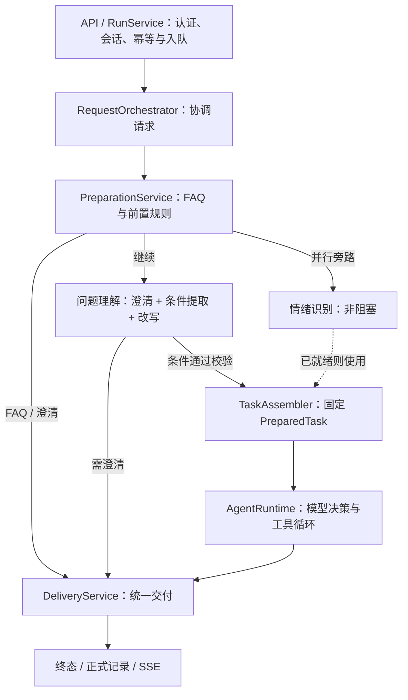

# Tianmu 运营 Agent

独立的 Java 17 / Spring Boot 服务，负责问题准备、受控执行与证据交付。

[项目首页](../README.md) · [部署说明](../docs/DEPLOYMENT.md) · [API 契约](docs/接口契约.md) · [贡献指南](../CONTRIBUTING.md)

## 开发启动

从仓库根目录执行：

```sh
mvn -B -f tianmu-agent/pom.xml verify
java -jar tianmu-agent/target/operations-agent-0.7.0-SNAPSHOT.jar
```

默认 `demo` 模式监听 `127.0.0.1:8201`，无需 Key 和中间件。请求示例见[快速开始](../README.md#快速开始)。在本模块目录也可执行 `mvn test` 或 `mvn spring-boot:run`。

## 分层与依赖



| 目录 | 职责与约束 |
| --- | --- |
| `api/` | HTTP / SSE，接口与鉴权接入 |
| `preparation/` | FAQ、前置规则、一次问题理解与并行情绪分析 |
| `application/` | 任务组装、受限历史视图、统一交付 |
| `runtime/` | 请求编排、循环、状态与调度；`control/` 负责超时、取消和终态竞争 |
| `harness/` | Hook、Transform 与 Trace |
| `tool/` | 工具注册、参数与范围校验、受控执行 |
| `skill/`、`prompt/` | 资源 Catalog、版本与快照 |
| `access/`、`query/`、`model/` | 身份、业务查询与模型端口 |
| `adapters/`、`demo/` | 外部系统适配与本地模拟实现 |
| `core/`、`resource/` | 共享契约与有界资源读取 |

理解调用超时或候选条件与服务端解析冲突时追问；仅改写无效时回到原文。情绪只取已就绪结果。模型提取的条件不直接作为授权或执行条件。

业务 SQL 位于根工程的 `agentbridge/`，模型协议位于模型适配器。模型返回决策，Runtime 执行工具；工具不能直接控制终态或发送 SSE。

## 新增能力放在哪里

以下资源路径均相对于 `src/main/resources/`：

| 扩展 | 位置 / 接口 |
| --- | --- |
| Skill | `skills/<name>/SKILL.md` + `skill.json` |
| Tool | 实现 `AgentTool` 并注册 Bean；在 `tools/<name>/tool.json` 声明描述与 Schema |
| Prompt | `prompts/` 正文 + `index.json` 中的 ID / 版本 |
| FAQ | `faq/`；更换来源实现 `FaqPort` |
| 业务条件 | `QueryReadinessPolicy` / `TaskSpecificationResolver` |
| 模型 | `ModelPort` / `PreparationModelPort`，落实截止时间与取消 |
| 治理 | `AgentHook` / `TransformHook<T>` |
| 存储与导出 | 仓储端口、`ObjectStore` / `TraceSink` |

Skill 通过 `read_skill` 激活业务工具。`ToolContext` 仅提供必要宿主能力，框架校验参数、权限与固定任务条件。资源启动时校验并形成快照，当前修改后需要重新构建和启动。

Hook 分为观察与执行前拦截：Observer 失败隔离，Gate 失败关闭。Transform 按类型串联载荷，逐次检查不变量。Java 插件属于可信代码，不是隔离沙箱。

完整示例见[工程目录与扩展规范](docs/工程目录与扩展规范.md)；治理契约见 [Trace / Hook](docs/Harness-Trace与Hook设计.md)与[变换链](docs/Hook变换链设计.md)。

## 数据与恢复约定

- MySQL 是正式记录的权威来源，终态及关联交付记录在同一事务提交。
- Redis 保存可重建的授权历史视图；完整结果放在私有对象目录。
- Trace 使用独立的本地文件 Outbox，异步投递 JSONL / Kafka；与存储 Outbox 分开。
- 持久化仅支持单写实例。重启可查询已完成任务、恢复符合条件的排队任务；在执行任务结束为 `RUNNER_LOST`。
- 当前业务指标是指定日期内已入库且仍保留的弹幕数，不代表完整发送总量。

## 验证与进一步阅读

从仓库根目录执行：

```sh
mvn -B -f tianmu-agent/pom.xml verify
python scripts/smoke_demo.py --jar tianmu-agent/target/operations-agent-0.7.0-SNAPSHOT.jar
git diff --check
```

普通测试无需模型 Key；真实存储测试需隔离 MySQL / Redis，并显式启用 `AGENT_STORAGE_IT=true`。CI 不调用收费模型。

- [入口与并行预处理](docs/统一入口与并行预处理.md)：顺序、汇合、降级和取消。
- [持久化存储接入](docs/持久化存储接入.md)：配置、事务、恢复与删除。
- [P0 业务接入](docs/P0业务接入.md)：身份、授权、指标口径和 SQL 对账。
- [部署说明](../docs/DEPLOYMENT.md)：profiles 与环境变量。
- [路线图](../docs/ROADMAP.md)：尚未实现的能力与后续方向。
