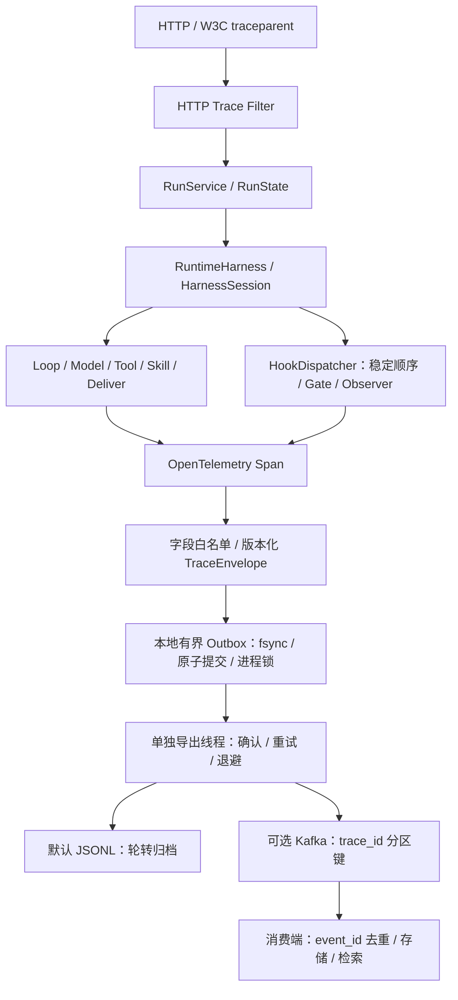

# Harness v0.2：Trace 与 Hook

v0.3 增量：已增加类型化 TransformHook<T>，与本文的 Observer/Gate 契约并存。
上下文和结果变换不修改 HookEvent，而通过返回新值组合；详见《Hook变换链设计》。

2026-10-24 部署进展：staging 已实际启用 Kafka → ClickHouse，含断线补发、消费恢复、重复事件查询去重与异常消息隔离；见 [实际验收](Kafka-ClickHouse验收.md) 和 [部署操作](../../deploy/KAFKA_TRACE.md)。

## 目标与当前实现

这次实现两个可独立扩展的能力：

1. 生命周期 Hook：在明确边界观察、校验和拒绝执行，无需修改主循环来增加插件。
2. Trace：使用 OpenTelemetry API / SDK 建立父子 Span，携带到线程池；完成的 Span 转为带版本的结构化 JSON，
   通过本地持久化缓冲导出到文件或 Kafka。

模型、业务查询、会话、预算、事实核验仍沿原有接口演进。当前没有接真实模型或真实 Tianmu 数据。
这条链路收集运行追踪元数据；普通应用日志通过 MDC 关联 trace_id / span_id / run_id，不会把所有 stdout 原文发送 Kafka。

## 架构



OpenTelemetry 1.49.0 和 Kafka Client 3.9.1 版本由 Spring Boot 3.5.4 BOM 管理。
没有注册全局 OpenTelemetry 单例，使用应用自己的 Tracer / SdkTracerProvider Bean，便于测试和替换。

## Hook 扩展契约

实现 `AgentHook` 并注册 Spring Bean 即可。注册项包括：唯一 name、order、points、mode。
启动时验证并冻结注册信息，按 order 升序、同序按名称排序。非法名称、重复名称、在 post 阶段注册 Gate 会启动失败。

| HookPoint | Gate 可用 | 实际时机 |
|---|---|---|
| REQUEST_START | 是 | 任务登记后、入执行队列前 |
| PRE_ROUTE | 是 | 正式执行后、进入 Loop 前 |
| PRE_MODEL / POST_MODEL | 前置可用 | 每次模型调用的前后 |
| PRE_TOOL / POST_TOOL | 前置可用 | 工具调用外层，包含 read_skill 等全局工具 |
| PRE_SKILL / POST_SKILL | 前置可用 | Skill 元信息已查到、激活其工具前后 |
| PRE_DELIVER / POST_DELIVER | 前置可用 | 回答或澄清的交付前后 |
| ON_ERROR | 否 | 任务首次转为 FAILED |
| ON_CANCEL | 否 | 首次取消，包括排队取消 |
| REQUEST_END | 否 | 任务终态且当前 worker 已清理完成 |

Gate 可以抛出 `HookRejectedException`；其他 Gate 异常也统一视作拒绝，任务以 HOOK_REJECTED 失败。
Observer 异常被隔离，记录失败 Span 和计数，不改变业务结果，不阻止后续 Observer。
前置 Gate 拒绝后，同一阶段的后续前置 Hook 不再运行；已进入阶段的 post Hook 仍会收到失败元信息。
post 的 `operation.executed=false` 表示前置阶段已拒绝，不能当作业务调用成功。

HookEvent 是不可变快照，仅含版本、时点、任务/Trace/Span ID、步数、时间与白名单标量属性。
插件拿不到可变 RunState、权限上下文、凭证、完整问题、原始业务行或模型输出。
Gate 只能增加限制，运行时原有的权限、参数、Skill 激活和证据归属校验始终执行。

### 示例：工具调用次数策略

```java
@Component
final class ToolStepGate implements AgentHook {
    public String name() { return "tool-step-policy"; }
    public Set<HookPoint> points() { return Set.of(HookPoint.PRE_TOOL); }
    public Mode mode() { return Mode.GATE; }
    public int order() { return -100; }
    public void onEvent(HookEvent event) {
        if (event.step() > 4) throw new HookRejectedException();
    }
}
```

扩展可用于指标、额外策略或审计适配器。预算的预占/结算、上下文压缩、结果变换应使用专门业务接口，
不通过修改 HookEvent 或吞掉异常来实现。插件是受信任的同进程代码，不是运行不可信插件的沙箱。

Hook 当前同步运行，要求快速、线程安全、避免网络阻塞。慢 Hook 会直接增加阶段时延；Span 可定位耗时。
本版没有强制 Hook 超时或隔离执行池。需要远程观测时，把元信息提交到有界队列，不在回调中等待远端。

## Trace 层级与跨线程

```text
http.agent                 # 创建任务的 HTTP 接入 Span
└─ agent.run               # 从创建入队到执行清理完成
   ├─ hook.request_start
   ├─ agent.route
   ├─ agent.loop           # loop.step 区分迭代
   │  ├─ agent.context
   │  ├─ agent.model
   │  │  ├─ hook.pre_model
   │  │  └─ hook.post_model
   │  └─ agent.tool
   │     ├─ hook.pre_tool
   │     ├─ agent.skill
   │     └─ hook.post_tool
   ├─ agent.deliver
   └─ hook.request_end
```

模型/工具/阶段失败的 Span 标记 ERROR，并记录安全错误码和异常类型；不记录异常消息或堆栈文本。
失败任务另有 ON_ERROR，取消任务有 ON_CANCEL。取消不被自动当作系统错误。
root Span 在 worker 清理后结束，因此阻塞适配器晚返回也不会导致 request_end 重复或根 Span 提前结束。
进程被强杀时，未结束 Span 可能不存在；本地 outbox 只能恢复已经提交的记录。

入口接受合法 W3C traceparent / tracestate，无效值由标准传播器处理；响应头增加 X-Trace-ID。
Snapshot 增加 traceId 字段，便于前端报错定位。跟踪上下文只做关联，不能用来授予用户权限。
当前本地总是采样记录，远端 sampled=0 也不会关闭本地 Span 记录；尚未引入采样配置。

RunSession 保存显式 Context，排队执行、取消 HTTP 线程、失败与结束回调均使用该 Context。
未来并行工具必须使用 `RuntimeHarness.contextual(runnable)` 或显式 capture / makeCurrent；
权限上下文仍要显式传参，不能从 Trace Baggage 或 ThreadLocal 推断。
MDC 每个 Scope 退出后恢复原值，避免线程池串任务。普通日志可通过相同 ID 关联。

HTTP Span 记录接入阶段；每次 SSE 订阅另有 terminal_delivery Span，记录首次有效内容提交发送的耗时和重放标识。字段见 [Trace 业务语义](Trace业务语义与字段.md)。
终态监听在 RunState 状态锁外执行；DONE 后拒绝继续追加进度，防止取消与晚到结果破坏事件流。

## Kafka 与本地缓冲的投递语义

默认 `harness.trace.sink=file`，没有 Kafka 也能启动。源目录：`./var/trace`。

- `pending/*.pending`：未得到目的端确认的 JSON；event_id 在首次创建后保持不变。
- `pending/.lock`：进程级文件锁；同一目录不能被两个应用实例同时使用。
- `pending/*.corrupt`：损坏记录隔离，保留待排查，并继续占用容量。
- `pending/*.tmp`：原子提交前的临时记录；异常退出遗留文件会计入容量，不擅自当作完整记录发送。
- `archive/spans.jsonl`：本地归档，默认 5 MiB 轮转、保留 3 个备份。

每个已结束 Span 经最终白名单过滤后写临时文件，force(true)，原子重命名为 pending 后才交给导出 worker。
磁盘不支持原子重命名时写入失败并计数，不退化为可能产生半条记录的发布方式。
导出线程收到 Kafka ACK 或文件归档完成后才删除 pending；失败保留并指数退避，加少量抖动，最高约 30 秒。
启动时重放 pending，目的端成功但删除前崩溃可能重复投递，所以消费端按 event_id 幂等。

Kafka 生产者启用 acks=all、幂等生产、重试和受限 in-flight；设置 metadata 阻塞、请求与交付超时。
Kafka 记录键为 traceId，同一 Trace 在分区数不变时进入同分区；消费端仍需按 Span 关系与时间重建。
不承诺不同 Trace 的全局顺序，也不承诺跨重启 exactly-once。
当前单导出 worker 逐条等待确认，设计目标是基架可验证；大吞吐需要后续批量化或接入 Collector。

默认待发容量为 10000 文件 / 64 MiB，单条最大 64 KiB。满额或磁盘故障时拒绝新追踪记录并计数、限频告警；
业务按既有权限和状态机继续执行。Kafka 不可用不会直接阻塞模型/工具等待网络，但 Span 结束仍有同步本地磁盘 I/O。
容量、目录和文件轮转可配置。每个副本使用独立可持久化目录，不能把共享目录当作分布式队列。

`OutboxSpanExporter.stats()` 暴露 pendingRecords / pendingBytes / enqueued / delivered /
enqueueFailures / deliveryFailures / quarantined。尚未暴露公网诊断端点或 Prometheus，后续可绑定 Micrometer。

这里的 Trace 允许在容量耗尽时丢弃新记录，不是“不可丢审计”。需要审计强保证时，另建可靠 AuditRecorder 与事务 outbox，
并规定审计失败是否阻断业务；不能只改 acks=all 就宣称审计永不丢。
文件 force 和原子移动仍不能保证所有文件系统/断电场景的硬件持久性，也没有覆盖整机或持久盘丢失。

## JSON 数据契约

Kafka value 是 TraceEnvelope JSON，当前生成 v1.1，旧 v1.0 待投递记录仍可重放；不是 OTLP protobuf。下面保留 v1.0 基础结构示例，新增字段见 [Trace 业务语义](Trace业务语义与字段.md)：

```json
{
  "schemaVersion": "1.0",
  "eventId": "UUID",
  "serviceName": "Tianmu-operations-agent",
  "serviceVersion": "0.2.0",
  "traceId": "32 lowercase hex",
  "spanId": "16 lowercase hex",
  "parentSpanId": "16 lowercase hex",
  "name": "agent.model",
  "kind": "INTERNAL",
  "startTimeUnixNano": 1,
  "endTimeUnixNano": 2,
  "durationNanos": 1,
  "status": "UNSET",
  "attributes": {"run.id": "UUID", "loop.step": 1}
}
```

Header 包含 schema_version 和 event_id。消费端处理未知字段时保持向前兼容；不认识主版本时隔离而非盲目解释。
消费端事务性写入存储与 event_id 去重键之后再提交 Kafka offset，避免边消费边丢数据。
Span 不含完整 Prompt、认证 Token、弹幕原文、凭证、工具参数、内部思考和完整模型回答。
可信身份中的租户、用户和会话标识用于关联查询。LLM Token 数来自提供方 usage，缺失时显式标注统计不完整；费用尚未接入。

## 启用与读取 Kafka

本地开发示例：

```powershell
docker compose -f infra/kafka/compose.yml up -d --wait
docker compose -f infra/kafka/compose.yml exec kafka /opt/kafka/bin/kafka-topics.sh --bootstrap-server localhost:19092 --create --if-not-exists --topic Tianmu.agent.trace.v1 --partitions 3 --replication-factor 1 --config retention.ms=604800000

$env:HARNESS_TRACE_SINK = 'kafka'
$env:KAFKA_BOOTSTRAP_SERVERS = '127.0.0.1:19092'
.\scripts\dev.ps1 -Action run
```

另开终端调用 README 中的业务请求，然后读取：

```powershell
docker compose -f infra/kafka/compose.yml exec kafka /opt/kafka/bin/kafka-console-consumer.sh --bootstrap-server localhost:19092 --topic Tianmu.agent.trace.v1 --from-beginning --property print.key=true
```

示例只供本地开发，Broker 端口绑定 127.0.0.1；单节点配置未做高可用。Docker 服务需先由开发者启动。
生产使用受控 Kafka 集群、适当副本数/min.insync.replicas、Topic ACL、保留策略与 SASL_SSL。
支持 KAFKA_SECURITY_PROTOCOL / KAFKA_SASL_MECHANISM / KAFKA_SASL_JAAS_CONFIG 环境变量；凭证不提交仓库。
如果应用运行在容器里，需要配置可达的 advertised.listeners，不能直接沿用 localhost。

改为其他目的端时注册自己的 TraceSink Bean，无需改 Runtime 或 HookDispatcher。
`TraceSink.close()` 必须幂等，以兼容导出器与 Spring 的资源清理。最终 JSON 契约另附 `trace-envelope-v1.schema.json`。
若需要 Tempo/Jaeger 等标准追踪后端，可给 SdkTracerProvider 增加原生 OTLP SpanExporter/Processor；
不能把这份 JSON 直接当作 OTLP 发送。

## 官方资料

- [OpenTelemetry Trace API](https://opentelemetry.io/docs/specs/otel/trace/api/)：Span 与传播模型。
- [Kafka Producer 配置](https://kafka.apache.org/39/configuration/producer-configs/)：确认、幂等与交付超时。
- [Apache Kafka Docker 示例](https://github.com/apache/kafka/tree/3.9.1/docker/examples)：开发环境参考。
- [Collector 队列与持久化](https://github.com/open-telemetry/opentelemetry-collector/tree/main/exporter/exporterhelper)：后续标准采集链路参考。
