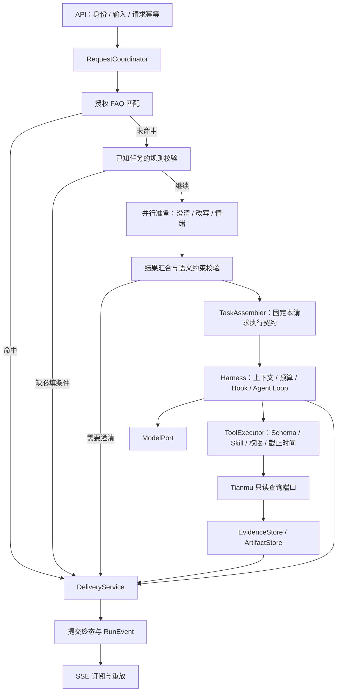

# 架构评审与演进方案

日期：2026-10-21。依据 v0.5 源码评审。本文保留 v0.5 评审背景；v0.6 已落实前置顺序、任务包、交付拆分、受限工具上下文和事件传输分离，详见《统一入口与并行预处理》。v0.7 又接通 MySQL、Redis 近期视图和私有文件对象，实际范围见《持久化存储接入》。六个逻辑模块的完全解耦、多写实例、远程对象适配和费用账本仍为后续方案。

## 1. 设计判断

以当前学生协作、单 Agent、只读运营分析的范围，采用一个可部署的 Spring Boot 应用，内部划清模块及依赖方向。已有 Skill / Tool / Prompt / FAQ 目录和扩展接口保留。优先完成任务契约、执行边界及真实业务闭环；达到独立扩容或运维隔离需求时再拆进程。

架构目标：业务同学能加能力，模型同学能换适配器，Runtime 保持稳定；每次调用有明确输入、权限、预算和结果归属；失败、取消和断线可解释。

## 2. 建议的请求路径

FAQ、澄清和 Agent 答案共用交付服务，以不同答案来源规则校验。FAQ 用已批准条目 ID/版本追溯；业务结论要求指标证据；三者共用终态竞争、事件和审计边界。

已知必填条件尽早检查。例如“查询视频1001的弹幕数”缺日期，可以直接问日期，无需先支付三次模型调用。小模型继续判断语义歧义；新业务未匹配某条规则时，不能被某个指标专用校验器错误拦截。

## 3. 六个逻辑模块

| 模块 | 放什么 | 依赖约束 |
|---|---|---|
| contracts | IDs、状态/原因枚举、任务和结果等不可变契约 | 不依赖 Runtime、Spring、模型 SDK 或业务存储 |
| kernel | Agent Loop、Hook 链、取消与预算控制、模型/工具执行接口 | 只依赖稳定契约与抽象端口 |
| application | 统一入口、准备流程、TaskAssembler、DeliveryService、任务/会话用例 | 协调 kernel 和端口，不写 HTTP、Kafka 或 SQL 细节 |
| capabilities | 具体 Tool、Skill 定义、业务条件检查、指标结果渲染 | 通过接口接入 kernel；通过业务端口访问数据 |
| adapters | DeepSeek、Tianmu 查询、资源加载、存储、Trace/Kafka、HTTP/SSE | 实现内层端口，依赖方向指向内层 |
| bootstrap | Spring Boot 入口、Bean 装配、环境/profile 配置 | 组装各模块；业务执行逻辑不放在这里 |

这些首先是包边界。当前不必立刻拆六个 Maven 工程；先通过依赖测试约束包访问，等多人开发或复用需求明确后再物理拆模块。

资源仍放在 resources/skills、tools、prompts、faq。Catalog 对外提供不可变定义，classpath/远程文件的读取方式由资源适配器负责。目录独立与依赖独立需要同时成立。

## 4. 当前代码的主要改进点

| 现状 | 影响 | 建议 |
|---|---|---|
| RunState 持有业务状态、工具历史、证据、取消、HarnessSession、SseEmitter，并同步发送 SSE | 扩展、持久化和多实例会牵动同一个对象；慢发送可能拖住状态锁 | 状态聚合、执行上下文、事件存储、SSE 订阅拆开 |
| ToolContext 直接暴露完整可变 RunState | 新工具可直接修改激活 Skill、证据、步骤甚至终态，职责范围过大 | 提供受限 ToolExecutionContext，只暴露必要能力接口 |
| core.AgentTypes 引用 runtime.control.StopReason | 公共契约反向依赖执行实现 | 将稳定枚举放 contracts；业务 Metric 类型归业务契约 |
| FAQ 的交付方法放在 AgentRuntime 中 | 不进入循环的路径仍依赖循环类，答案来源规则难统一 | 提取 DeliveryService，Runtime 返回执行结果 |
| 准备分支同时启动，但按情绪 → 澄清 → 改写依次等待 | 情绪慢时，即使已经知道要澄清也不能及时返回 | 按关键结果汇合；澄清确定后尽早返回，情绪可降级 |
| 已知条件校验在三个模型调用之后 | 明确缺条件也要付出模型开销 | 前置规则检查；模型后继续校验解释和改写一致性 |
| PreparedRequest 只有原问题、改写、情绪和降级标记 | 时间解释、版本、能力集合、预算与下一阶段数据交接不完整 | 增加独立 PreparedTask，不把所有字段堆到 ModelContext |
| 部分预算和指标只覆盖 Harness | 三个小模型调用、失败和收尾成本难统一核算 | 全链路 ModelGateway / BudgetManager，按调用阶段分组记录 |

## 5. 任务契约与受限执行上下文

建议分清三个对象：

- Request：用户原始输入和传输层信息。
- PreparedTask：通过校验的不可变执行说明，记录对象、日期、任务类型、来源和版本。
- ExecutionContext：运行中的截止时间、取消、工具调用记录、上下文视图与受限存储接口。

PreparedTask 至少应固定 requestId / runId / sessionId（可选）、原问题、执行 Query、结构化任务条件、业务日期/时区、资源版本、能力上限、输出约束和预算。尚未建设会话时，sessionId 保持可选，不先实现一套空的会话服务。

视频 ID、日期、指标等条件应标注来源，例如用户原文、明确追问或确定性时间解析。Query 改写不能悄悄补造条件；数值正则相同也不能证明两句话语义等价。

“昨天”以请求开始时捕获的业务日期解释。当前循环每轮重新取 LocalDate.now，跨午夜时可能改变含义；任务包可消除这个问题。Prompt/Skill/工具声明版本也按请求固定，避免热更新后同一任务前后不一致。

固定任务解释和配置，不等于固定授权结果。工具实际执行时仍应检查当前权限；撤权和紧急禁用要能中止后续动作。模型和 Skill 不得自行扩大工具能力或资源范围。

ToolExecutionContext 只提供 runId、可信身份/授权接口、deadline、cancellation、证据登记、产物读写等必要能力。工具返回 ToolResult，由 Runtime 决定继续还是交付；不允许工具直接改任务终态或发送 SSE。

## 6. 并行准备的合理边界

保留当前三个任务的独立接口，但不把三者视作同样重要的前置依赖。

| 分支 | 用途 | 汇合策略 |
|---|---|---|
| 澄清判断 | 判断任务是否有足够条件或存在歧义 | 关键路径；模型不确定时澄清，不能猜条件 |
| Query 改写 | 规范表达、辅助检索与规划 | 保留原文；验证后采用，失败回原文 |
| 情绪识别 | 回答语气、解释方式等软策略 | 短预算，拿不到则 UNKNOWN；不阻塞业务和权限决策 |

三个分支各有等待预算，同时受请求总截止时间约束。需要澄清一旦确定，就结束该请求并取消无用工作；已经在提供商侧执行的取消请求不保证没有费用。

还应保留“单次小模型返回三类结构化结果”的可替换实现，用同一评测集比较延迟、误判率和总 Token。是否合并由测量决定；当前不需要同时建设两套生产实现。

## 7. Harness 的稳定边界

Harness 负责模型/工具主循环，以及上下文、预算、取消、Hook 和执行记录。它不承担某个视频指标的 SQL、FAQ 内容或聊天历史数据库实现。

权限、Schema、预算硬上限、结果归属和终态控制是固定边界。Hook 用于策略扩展、脱敏和观测；新增 Hook 不能取消这些约束。观测故障可隔离，治理拒绝和变换失败需明确终止规则。

原始证据与模型可见上下文分开：EvidenceStore 保存原始事实，ContextBuilder 生成受预算限制的视图，ArtifactStore 存大结果。压缩只能改视图。当前内存证据可以先实现这些接口，暂不要求独立部署存储服务。

Token/费用统计覆盖预处理、主模型和收尾。调用前预留、成功后结算；网络中断导致提供商用量未知时，应记录未知状态，不能把缺失 usage 当作零成本。Trace 提供观测，预算与账本由单独组件维护。

后续可为固定指标查询增加确定性 WorkflowExecutor，并与 AgentLoopExecutor 共用工具、预算和交付。当前先稳定现有 AgentLoop，无需同时引入复杂工作流引擎、A2A 或多 Agent。

## 8. 事件、持久化与可观测性

先定义 RunRepository、RunEventStore、ConversationStore、EvidenceStore、ArtifactStore 等端口；仅实现当前用到的接口。内存实现可继续演示，正式业务再按可靠性目标选择持久化实现。

正式终态建议由 DeliveryService 校验后，原子写入任务状态及 RunEvent，再异步通知 SSE。客户端通过事件序号去重和重放。进程内 CAS 不等于跨实例唯一提交，也不等于客户端恰好收到一次；多实例需数据库版本控制、任务归属与租约等机制。

Trace 继续通过 Kafka 收集，限制容量并允许遥测失败隔离。重要审计采用持久化记录或数据库事务 outbox，不能沿用 Trace 缓冲满时可丢新记录的保证。任务恢复也不能通过重放 Trace 实现。

近期不必把 Redis 同时用来承载任务、记忆、分布式锁、缓存和消息通知。先为具体访问模式确定归属与可靠性，再选择实现。

## 9. 演进顺序

1. 收紧依赖：contracts 与 kernel 解耦，拆分 RunState，统一 DeliveryService，工具改用受限上下文。
2. 建立 PreparedTask、TaskAssembler，固定业务时间与资源版本，调整准备阶段的关键路径与规则检查位置。
3. 对接真实 Tianmu 身份和只读查询，建立可对账的真实任务评测集。
4. 补齐全链路预算、上下文视图、证据/产物端口与澄清续接。
5. 按上线需要落地任务/事件持久化、审计、Kafka 查询端和压力测试；再评估多实例和独立 Worker。

前两步以模块边界测试、现有功能回归和一个端到端任务验收为准。工程复杂度的增加应对应实际边界问题或验证需求，不以文件夹、接口或服务数量作为完成标准。
