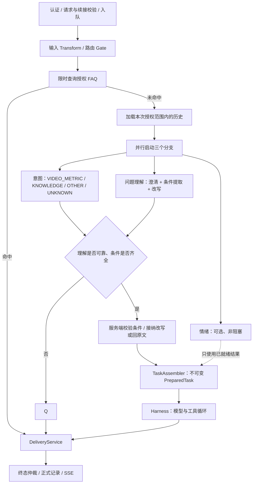

# 统一入口与问题理解

更新：2026-10-24。本页描述当前实现：FAQ 短路 → 历史快照 → 意图、问题理解、情绪三路并行 → 服务端汇合校验 → PreparedTask → Harness。

## 执行顺序



所有问题提交 `POST /api/agent/runs`，统一返回 202 和任务快照。FAQ 表示绕过模型和工具循环，不改变异步响应协议。

## 为什么这样安排

| 阶段 | 执行方式与原因 |
| --- | --- |
| 身份、输入、会话与续接 | 串行前置，先固定可信身份与原始任务范围 |
| FAQ | 模型调用前查询；命中则不启动三个识别分支 |
| 历史 | FAQ 未命中后加载授权历史，三个分支读取同一份不可变快照 |
| 意图 | 独立关键分支，只分类当前任务；不能授予权限或提供执行条件 |
| 问题理解 | 一次小模型调用完成澄清判断、条件提取、Query 改写，避免重复理解与判断冲突 |
| 情绪 | 与问题理解并行，汇合时只取已完成结果，不额外等待 |
| 校验与组装 | 汇合后运行确定性规则、意图一致性和条件校验，再固定任务；模型候选不能成为授权依据 |

意图与问题理解是关键路径，分别使用独立截止时间；并行耗时取决于较慢的关键分支，而不是三次时延之和。意图未知或不可用时保守追问，已确定的视频指标任务不能被识别为其他意图后继续执行；视频指标意图缺乏可验证条件时也不直接放行。确定性缺条件规则优先提供具体问题。结束时取消未完成分支。情绪只取汇合时已就绪的结果，条件可靠但改写无效时使用原文。

三个并发请求仍按三次模型尝试计入预算和提供方用量。本项目没有 kflow 老链路；本次不增加虚构回退、账户尾号灰度或外部 FAQ 检索评分阈值。

## 模型输出与条件边界

`PreparationModelPort` 提供三个方法：

- `understand(Input, CallControl)` → `Understanding`。
- `emotion(Input, CallControl)` → `Emotion`。
- `intent(Input, CallControl)` → `Intent`，严格枚举 VIDEO_METRIC、KNOWLEDGE、OTHER、UNKNOWN。

三个分支读取相同的规范化问题、业务日期和受限历史，不读取另一分支的结果。模型适配器仅发送必要输入，不发送完整身份范围。理解分支继续合并澄清、条件提取和改写，不增加第四次改写模型调用。

```json
{
  "needsClarification": false,
  "clarificationQuestion": null,
  "conditions": {
    "video_id": 1001,
    "date": "2026-10-22",
    "metric": "bullet_count"
  },
  "rewrittenQuery": "查询视频1001昨天的弹幕数"
}
```

要求澄清时，必须提供问题，conditions 为 {}，rewrittenQuery 为 null。结构化字段、布尔类型、条件标量和载荷边界由适配器与契约校验。

候选条件的键和值必须与服务端 `TaskMeaning` 从原问题解析的条件一致。数字允许 JSON 整数类型差异，但字符串 ID 不能替代数字。缺失条件、多余条件、视频或日期替换均触发保守澄清；未知任务也不能凭模型填充条件。

安全改写继续检查长度、数字、时间与指标词以及已知任务语义。当前条件解析器覆盖单视频弹幕、昨天或单个 ISO 日期；不承诺通用语义验证。未知任务的 conditions 只能为空，业务执行仍受工具校验约束。

`TaskAssembler` 使用服务端解析的 Specification 固定条件与来源，不直接保存模型候选作为执行条件。PreparedTask 同时固定权限、资源版本、工具上限、截止时间和模型尝试次数预算。

## 超时与失败

| 阶段 | 默认 Demo | DeepSeek profile | 失败处理 |
| --- | --- | --- | --- |
| FAQ | 300ms | 300ms | 普通故障降级到并行识别；权限或策略拒绝为硬失败 |
| 意图 | 2s | 10s | 超时、不可解析或普通故障：UNKNOWN 并追问，记录 intent 降级 |
| 问题理解 | 2s | 10s | 超时、不可解析或普通故障：追问，记录 understanding 降级 |
| 候选条件 | 同步校验 | 同步校验 | 与服务端解析冲突：追问，记录 understanding 降级 |
| 改写 | 随理解结果返回 | 随理解结果返回 | 空值、不合格或语义变化：回原文，记录 rewrite 降级 |
| 情绪 | 300ms 上限 | 3s 上限 | 汇合时未完成：UNKNOWN / skipped；已观测普通故障：UNKNOWN / degraded |
| 请求总时限 | 30s | 120s | 从创建起计算，统一取消所有分支 |

三路截止时间都从提交前计算，包含排队时间，并受总时限约束。等待一个关键分支不延长另一个的截止时间，已经在截止前完成的兄弟分支仍可使用。Future 中断不能强制停止不合作的客户端，真实适配器必须落实 CallControl。

`AgentException` 表达权限、预算等硬拒绝，不按普通故障忽略。取消和硬拒绝会通知其他分支；晚到结果不能覆盖终态。

阶段标记：

- `understanding`：合并后的理解调用。
- `intent`：独立意图调用。
- `emotion`：可选情绪调用。
- `rewrite`：理解结果中的逻辑子阶段，不代表独立模型调用。

FAQ 短路时，skippedStages 包含 intent、understanding 和 emotion。规则校验在三路汇合后执行。理解要求追问时 rewrite 被标记跳过；仅改写无效时 degradedStages 包含 rewrite。

## 调用预算与观测

`preparationCalls` 统计实际启动的意图 / 理解 / 情绪调用，正常上限为 3；分支在启动前被取消时可能更少。FAQ 短路为 0，不按固定值补记调用。

`modelCalls` 统计 Harness 与收尾，`totalModelCalls` 是两者之和，默认共用 16 次上限。该计数是请求内尝试次数，不是 Token 或费用账本。

Trace 包含 `agent.prepare.intent`（span.type=intent_recognition）、`agent.prepare.understanding` 与 `agent.prepare.emotion`。`preparation.intent` 只记录枚举分类，路由与根 Span 记录汇合后的分类，不保存问题正文。意图 Prompt 为 `preparation.intent`，理解 Prompt 为 `preparation.understanding`；内容与版本纳入任务资源快照。

## 配置迁移

使用 `agent.preparation.intent-timeout` 配置新增意图时限；understanding-timeout 与 emotion-timeout 保持各自语义。单独改写不是网络阶段，没有独立超时。

Java 自定义 PreparationModelPort 实现需新增 intent 方法。PreparedRequest 新增 intent 字段，旧记录缺失时读取为 UNKNOWN；保留旧构造器用于已有调用点。HTTP 输入不变，输出增加 preparation.intent，严格校验客户端需同步适配。历史终态读取不会因 UNKNOWN 重新执行任务。

执行器、SSE、存储和恢复边界保持既有约定，参见[持久化存储接入](持久化存储接入.md)和[接口契约](接口契约.md)。
